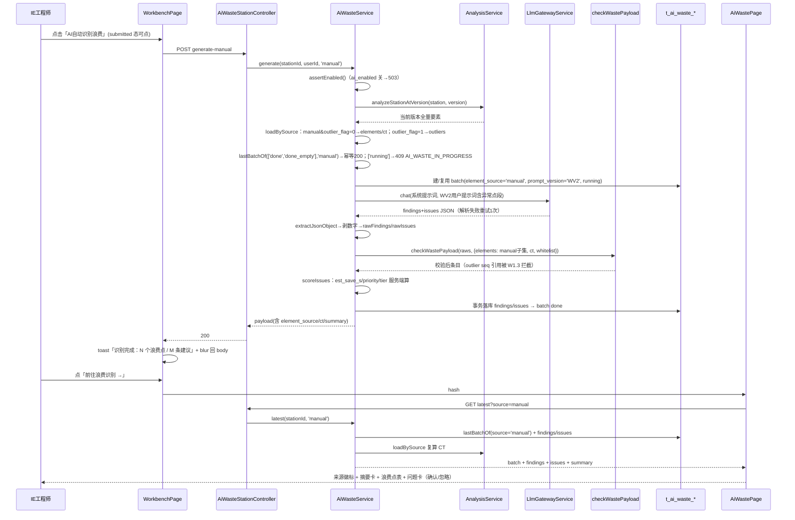

# 增量设计：分解工作台「AI 自动识别浪费」（手工分解线）

- 简体中文 ｜ 增量模块 ai-waste-manual ｜ 基线：ai-waste v3.40（P3-9，AI 线 53/53 契约 + 22/22 UI）｜ 覆盖：PRD P0-1~P0-7 全部、P1-1/P1-2/P1-3；P2-1/P2-2 不做（双页签与 `?source=` 路由预留接入点）。

## 1. 增量设计与决策点

**数据流**：工作台按钮 → `POST generate-manual` → `loadBySource(source='manual')`（analysis 当前版本 → manual 子集 + outlier 集 + CT=manual 子集 Σstd_time）→ 幂等/running 按 source 隔离 → 建 batch（element_source='manual'、prompt_version='WV2'）→ LLM（系统提示词 + WV2 用户提示词含异常点段）→ JSON 解析重试1次 → 剥数字 → W1-W3（ctx.elements 仅 manual 子集，outlier seq 被 W1.3 自然拦截）→ 服务端算数 → 事务落库 → toast + 跳 `#/ai-waste/:id?source=manual` → AiWastePage 手工页签呈现（徽标/摘要卡/两表/确认忽略）。

- **D1 端点形态 = 新端点 `generate-manual`**（service 内 `generate(stationId, userId, source='ai_assisted')` 共享实现）。理由：现有 `generate` 契约零改动（不为既有端点引入 body DTO，规避 whitelist 剥离与旧客户端兼容风险）；single-flight/幂等键天然按 source 隔离；PRD P0-1 要求独立控制器方法。
- **D2 来源隔离**：`lastBatchOf(stationId, statuses, source)` 增加 `b.element_source = :src`，**所有**调用点（幂等 done/done_empty、running、failed 复用、latest、batches）必须传 source；single-flight key 改 `${tenant_id}|${stationId}|${source}`；`latest`/`batches` 加可选 `?source=`，**默认 ai_assisted**（不传即旧行为逐字节不变 → 53/53 安全）。前端 AiWastePage 双页签（默认 ai_assisted 保住 22/22），工作台链接带 `?source=manual` 直达手工页签；App.tsx parseHash 仅对 ai-waste 分支拆 `?source=`（hash 不支持 query 的既定事实的 6 行修补）。
- **D3 submitted 脏检查 = 直接置位**（否决 skip-ref：submit 成功走异步 `load()`，ref 跳过与 effect 时序存在竞态；否决提交签名：需维护跨 submit→load 往返恒等的投影并排除 key/rated/va_reason，代码更多且隐涩）。实现：`update()` 一行 `setSubmitted(false)` 收口全部字段编辑（含自动描述/微调/拖拽），结构性 handler（addElement/addSameAsLast/splitAtPlayhead/commitAndNext/deleteElement/undoDelete/applyReuse/applyBatch/clearAll 已有）同置。submit 成功只 `setDraft`（不经 update）→ 不误触；之后任何草稿变更即复位 → 按钮与 1541 行「查看分析结果 →」链接同步置灰/隐藏（同款不一致顺带修复）。
- **D4 prompt WV2**：`WasteUserPayload` 增 `decomposition_source: 'ai_assisted'|'manual'`（首行「要素由手工分解写入」/「要素由 AI 自动分解写入」）与 `outliers?: {seq,type,desc,reason}[]`（段落标题明示「仅作线索、不计入 CT、不得在 element_seqs 中引用」）；`WASTE_SYSTEM_PROMPT` 去「AI 自动分解产出」硬编码改中性措辞并加异常点规则一句；`WASTE_PROMPT_VERSION` 'WV1'→'WV2' 全局 bump 随批落库，旧批 WV1 只读不变；两线共用 WV2 单一语境（不按 source 分叉版本）。
- **D5 距离/异常点信号**：三条代理信号（移物 dur_s≥2、desc 距离文本、同描述移物计数≥2）全部经既有 compact payload（dur_s/desc）与系统提示词既有信号措辞落地，**服务端零距离数字解析**；outlier 只进 prompt 的 outliers 段，**绝不进 `checkWastePayload` 的 ctx.elements** → `bySeq` 无 outlier seq → 全量引用整条剔除、部分引用裁剪（validator.ts 138-145 既有逻辑，零改）。实现红线：service 内 elements 与 outliers 两集合严格分离。
- **D6 前端改动面**：按钮置于 `wb-top-acts`「复用要素」后（v3.33 AI 切分按钮同址先例），`can('suggestion:generate')` 控制渲染，`disabled={!submitted||busy||wasteBusy}`（title「请先提交分解」）；点击 → 按钮转「分析中…」→ 200 弹 toast「识别完成：N 个浪费点 / M 条建议」+「前往浪费识别 →」链接；409 弹「已有识别任务进行中」+同链接；错误码文案透传；finally `blur()` 回 body。api.ts 增 `generateManual` 与 source 参数、类型 `AiWasteElementSource`；AiWastePage 双页签 + 来源徽标 + P1-3 摘要卡 + 批次来源列；CSS 仅加 `.wb-top-btn:disabled`（aw- 仍零定义、沿用 card+inline style）。单屏铁律：按钮在既有 38px 顶栏行内、零新浮层、结果跳既有第 6 页签，「不改已打磨的工作台」以 WorkbenchPage 构建产物字节数不变 + test-wb-v329 48/48 回归为证。

## 2. API 契约变更表

| 方法 | 路径 | 权限 | 请求 → 响应 | 错误码 | 兼容性 |
|---|---|---|---|---|---|
| POST | /stations/:stationId/ai-waste/generate-manual | suggestion:generate | 无 body → 同 generate 载荷（element_source='manual'、prompt_version='WV2'、含 ct/summary） | 403 无权限；400「当前版本没有手工分解要素（source=manual）」；409 `{code:'AI_WASTE_IN_PROGRESS',batch_id}`；503 服务关 | **新增**，不动现有 |
| POST | /stations/:stationId/ai-waste/generate | suggestion:generate | 不变（service 默认 source='ai_assisted'） | 不变 | **不改** |
| GET | /stations/:stationId/ai-waste/latest?source= | suggestion:generate | 响应新增 `ct` 与 `summary{by_type,total_est_save_s,est_pct_of_ct}`（additive） | 503 | **契约兼容变更**（不传 source=旧行为） |
| GET | /stations/:stationId/ai-waste/batches?source= | suggestion:generate | batches[] 每项已含 element_source（既有字段） | 503 | **契约兼容变更** |
| POST | /ai-waste/issues/:id/settle | suggestion:generate | 不变 | 不变 | **不改**（P0-6 ①零改动复用） |

## 3. 文件清单

| 相对路径 | 改动 |
|---|---|
| app/api/src/modules/ai-waste/ai-waste.service.ts | 【改】loadBySource / generate(source) / doGenerate(传 outliers+source) / runLlmAndValidate(WV2 prompt) / lastBatchOf(source) / latest·listBatches(source) / batchPayload(ct,summary) |
| app/api/src/modules/ai-waste/ai-waste.controller.ts | 【改】新增 generate-manual 方法；latest/batches 接 Query DTO |
| app/api/src/modules/ai-waste/prompt.ts | 【改】decomposition_source/outliers 参数与异常点段；系统提示词中性化 |
| app/api/src/modules/ai-waste/validator.ts | 【改】WASTE_PROMPT_VERSION='WV2'（W1-W3 规则零改） |
| app/api/src/modules/ai-waste/dto.ts | 【改】ListWasteBatchesQuery 加 `@IsOptional() @IsIn(['manual','ai_assisted']) source` |
| app/api/src/modules/ai-waste/entities/*.entity.ts、database.module.ts、migrate.ts | 【不改】element_source 列已存在（默认 ai_assisted，长度16容纳'manual'）；通配注册就位 |
| app/web/src/api.ts | 【改】aiWaste.generateManual；latest/batches 加 source 参数；AiWasteElementSource 类型 |
| app/web/src/App.tsx | 【改】parseHash 对 ai-waste 拆 `?source=`；AiWastePage 传 initialSource |
| app/web/src/pages/AiWastePage.tsx | 【改】source 双页签；load/generate/batches 按 source；来源徽标；P1-3 摘要卡；批次来源列 |
| app/web/src/pages/WorkbenchPage.tsx | 【改】顶栏按钮 + wasteBusy/wasteLink + 脏检查置位 + blur |
| app/web/src/styles.css | 【改】新增 `.wb-top-btn:disabled` 两行 |
| app/web/src/components/StationTabs.tsx、Breadcrumb | 【不改】第6页签/映射已就位 |
| app/api/test/ai-waste-contract.cjs | 【改】Phase B7 manual 线（约12断言） |
| app/web/test-ai-waste.cjs | 【改】手工页签用例（约4断言） |
| app/web/test-wb-waste-btn.cjs | 【新建】工作台按钮/脏检查 UI（约10断言） |

## 4. 数据结构

**无新表、无新列、无 migrate 变更**（PRD 目标3「零新建数据模型」成立）。`element_source='manual'` 落库点：`doGenerate` 的 `batchRepo.create({… element_source: source …})`；failed 批复用路径经 `lastBatchOf(…, ['failed'], source)` 只复用同源失败批（其 element_source 本就正确），update 无需携带该字段。findings/issues 经 batch_id 归属，天然按源隔离。latest 的 CT 由 `loadBySource` 现场复算（只读分析，不落列），summary 由服务端从 findings/issues 服务端字段汇总——前端零计算口径分叉（P1-3）。

```mermaid
classDiagram
    class AiWasteStationController {
      +generate(stationId, user)
      +generateManual(stationId, user)
      +latest(stationId, query)
      +batches(stationId, query)
    }
    class AiWasteService {
      -loadBySource(station, source) {elements, outliers, ct}
      +generate(stationId, userId, source='ai_assisted')
      -doGenerate(station, userId, elements, ct, outliers, source)
      -runLlmAndValidate(station, batchId, elements, ct, outliers, eff)
      -lastBatchOf(stationId, statuses, source)
      +latest(stationId, source?) / +listBatches(stationId, source?)
      -batchPayload(batch, ct?) / +settle(issueId, status, operator)
    }
    class WasteUserPayload {
      +station_id string / +ct number / +tt number
      +elements WasteCompactElement[] / +outliers WasteOutlierHint[]
      +decomposition_source 'ai_assisted'|'manual' / +waste_whitelist string[]
    }
    class ListWasteBatchesQuery {
      +source? 'manual'|'ai_assisted' / +version? number
    }
    class AiWasteBatch {
      +element_source 'ai_assisted'|'manual' / +prompt_version 'WV2' / +status running|done|done_empty|failed
    }
    AiWasteStationController --> AiWasteService
    AiWasteService ..> WasteUserPayload : buildWasteUserPrompt()
    AiWasteService ..> AiWasteBatch : lastBatchOf(source)
```

## 5. 调用时序



## 6. 任务列表（按实现顺序：后端→前端→测试）

| ID | 名称 | 文件 | 依赖 | 优先级 | 验收点 |
|---|---|---|---|---|---|
| T01 | 后端契约层（来源隔离 + WV2 + 新端点） | ai-waste.service.ts、ai-waste.controller.ts、prompt.ts、validator.ts、dto.ts | 无 | P0 | ① manual 线 200/400/409/503 语义正确；② AI 线 53/53 不回退；③ batch.element_source='manual'、prompt_version='WV2'；④ 引用 outlier seq 被 W1.3 剔除；⑤ 无新增依赖/配置（既有栈零变更，故无独立基础设施任务，T01 即契约基座） |
| T02 | 前端数据层与结果页双线化 | api.ts、App.tsx、AiWastePage.tsx | T01 | P0 | ① `?source=manual` 直达手工页签且其他路由 parseHash 行为不变；② 页签切换 latest/batches 按 source 隔离；③ 来源徽标+摘要卡数字与服务端一致；④ 默认页签 AI 线 22/22 回归 |
| T03 | 工作台入口与草稿脏检查 | WorkbenchPage.tsx、styles.css、test-wb-waste-btn.cjs(新建) | T02 | P0 | ① 无权限 DOM 无按钮；② 未提交/分析中置灰（title「请先提交分解」）；③ 提交后可点，成功 toast+链接+blur；④ 提交后改1条草稿按钮即置灰；⑤ submit 成功自身 load 不误触；⑥ test-wb-v329 48/48 工作台零回归 |
| T04 | 契约扩充与回归收尾 | ai-waste-contract.cjs、test-ai-waste.cjs、AGENT必读.md(看板) | T01,T02,T03 | P0 | ① Phase B7 manual 线约12断言（含双向来源隔离：纯 manual 站跑 AI 线须400而非幂等命中）；② ai-waste 契约 ≥65、UI ≥26；③ smoke 143、ai-suggest 62 零回退；④ 看板更新 |

## 7. 共享约定

- 错误码：409 体固定 `{code:'AI_WASTE_IN_PROGRESS', batch_id}`；manual 400 文案固定「当前版本没有手工分解要素（source=manual）」；AI 线 400 文案原样保留。
- 命名：service 私有 `loadBySource(station, source)`；DTO `ListWasteBatchesQuery.source`；前端 `AiWasteElementSource='manual'|'ai_assisted'`；工作台 state `wasteBusy`/`wasteLink`；链接统一 `#/ai-waste/:stationId?source=manual`。
- 口径：prompt_version 新值 'WV2'；CT 按源各自独立不合并（PRD §4.7）；LLM 禁产数字铁律不变；issues 恒「待处理」无直接执行按钮。
- API 演进 additive 原则：latest 新增 ct/summary 不改既有字段语义；查询参数默认值必须保证旧调用行为不变。
- 测试纪律（跨会话有效）：UI 测试自建前置+finally 还原，禁依赖会话残留（v3.41 教训）；契约 Phase 0 清 t_ai_setting 会清掉真实方舟 Key，**跑完必须重 PUT llm-config**；UI 测试禁并行；API 重启前必须 `npx tsc -p tsconfig.json --outDir dist`（nest build 锁死）。

## 8. 风险与回滚

1. **lastBatchOf 漏加 source 过滤** → 跨线幂等假 200/假 409（correctness 关键）→ 缓解：统一走带 source 的私有方法；契约测试双向隔离断言（纯 manual 站跑 AI 线须 400、纯 AI 站跑 manual 线须 400，而非幂等命中）。
2. **outliers 误入 validator ctx** → outlier seq 被当合法引用污染数字 → 缓解：elements/outliers 集合分离 + 引用 outlier seq 的 finding 被 W1.3 剔除的专项断言。
3. **WV2 改变 AI 线 LLM 输入**致真实模型输出漂移 → 缓解：mock 契约不依赖 prompt 内容；提示词变化最小化（首行一句+可选段）；旧批 WV1 溯源不变。
4. **parseHash 改动波及其他路由** → 仅 ai-waste 分支拆 query、其余分支原样；smoke + 既有 UI 套件回归兜底。
5. **脏检查误触/漏触**（含 latest 新增 loadBySource 调用的只读成本，3s 轮询可忽略、try 降级 ct=0）→ 直接置位无 effect 机制；验收连测「submit→load 不误触」与「提交后改1条即复位」两场景。
6. **回滚**：全部为增量修改、DB 无结构变更，单 commit 还原即可，无需 migrate 回退。
