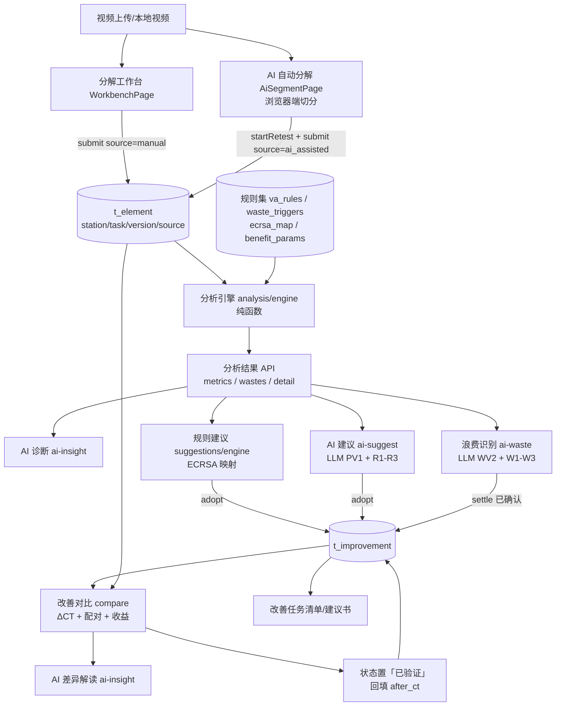
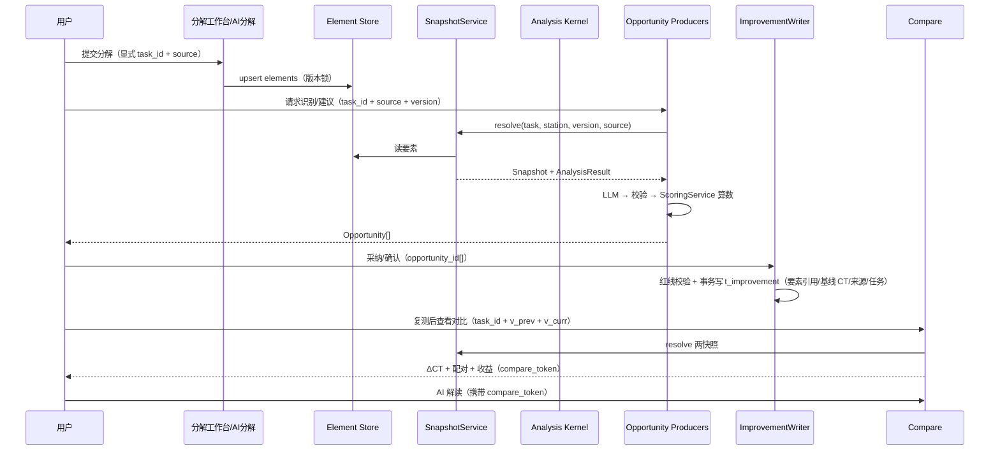

# 模块协作架构梳理 · 现状 → 问题 → 目标架构

> 日期：2026-11-23　范围：AI 分解工作台、分析结果、浪费识别、AI 建议、改善对比（含版本 Diff 与改善任务闭环）
> 方法：只读代码扫描（前端 `app/web/src`、后端 `app/api/src/modules`），未改动任何代码。
> 代码基线：`main` 工作区（含未提交改动）。
> 文中 `路径:行号` 均指当前工作区实际文件。

---

## 0. 结论先行（TL;DR）

1. **数据主干是清晰的**：`要素（t_element） → 分析引擎（纯函数） → 浪费/指标 → 建议 → 改善任务（t_improvement） → 复测对比`。问题不在主干，而在**主干旁边挂了三条并行的“建议产线”**，各自有表、各自算数、各自写同一张改善任务表。
2. **同一份事实有 4 套算法出口**：分析引擎的规则浪费、浪费识别模块的 LLM 浪费、AI 建议模块的 LLM 浪费、规则建议引擎的 ECRSA 候选。同一工位同版本可以同时看到三份互不一致的浪费清单与优先级。
3. **版本指针被当成“双来源线开关”用**：`t_station.version` 只有一个游标，而 AI 分解页会为新结果强制开新版本（`AiSegmentPage.tsx:886-898`），导致手工要素被封存在旧版——之后「浪费识别·手工分解线」在当前版本读到 0 条要素而 400。
4. **任务上下文（task_id）只在部分链路显式传递**：AI 生成/采纳带 `getCurrentTaskId()`，分析、对比、AI 解读、诊断不带；同一页面上的“当前任务”与展示结果可能不是同一口径。
5. **最需要先修的不是分层，而是三处会直接产生错误数据/错误文案的断点**：浪费识别确认后丢失要素引用、AI 解读与对比版本不一致、AI 建议提示词分类名与动态白名单不匹配导致产出被静默剔除。

---

## 1. 模块与代码地图

### 1.1 总表

| 模块 | 前端入口 | 后端 module | 主要持久化 | 权限点 |
|---|---|---|---|---|
| AI 分解工作台 | `#/workbench/:id`、`#/ai-segment/:id` | `elements`、`decomposition-tasks`、`stations`、`videos` | `t_element`、`t_decomposition_task`、`t_task_station`、`t_station` | `element:read/write` |
| 分析结果 | `#/analysis/:id` | `analysis`、`ai-insight` | 只读 `t_element` + 规则集 | `analysis:read`、`element:va-override` |
| 浪费识别 | `#/ai-waste/:id` | `ai-waste` | `t_ai_waste_batch/finding/issue/kb` | `suggestion:generate` |
| AI 建议 | `#/ai-suggestions/:id`、`#/ai-config` | `ai-suggest` | `t_ai_suggestion_batch/suggestion`、`t_ai_custom_dict`、`t_ai_setting`、`t_ai_llm_profile`、`t_ai_feedback_pattern` | `suggestion:generate`、`ai:governance`、`user:write` |
| 改善对比 | `#/compare/:id`、`#/diff/:id/:vA/:vB`、`#/improvements` | `compare`、`suggestions`、`ai-insight` | 读 `t_element`、读写 `t_improvement` | `compare:read/export`、`suggestion:status`、`suggestion:adopt` |

### 1.2 AI 分解工作台

**两条写入路径，语义不同：**

| 路径 | 触发 | 写入版本 | source | 说明 |
|---|---|---|---|---|
| 手工分解 | `WorkbenchPage` 提交 `POST /stations/:id/elements/submit` | 当前 `station.version` | `manual` | 本地草稿 → 校验 → 事务整版覆盖（`elements.service.ts:128-225`） |
| AI 自动分解 | `AiSegmentPage.doWrite` 同端点 | **有旧要素则先 `POST /retest` 开新版本** | `ai_assisted` | AI 要素独占新版本（`AiSegmentPage.tsx:886-903`） |

**对外接口（分解相关）：**

| 方法/路径 | 入参 | 出参 | 备注 |
|---|---|---|---|
| `POST /stations/:id/elements/validate` | `ccycle_count`、`cv`、`elements[]` | `{ok, errors[], warnings[]}` | 干跑，不落库 |
| `POST /stations/:id/elements/submit` | `bol_version?`、`cycle_count?`、`cv?`、`video_id?`、`task_id?`、`elements[]`（含 `source`） | `{station_id, version, ct, element_count, warnings, task_scope}` | 事务删当前版本该任务要素→重写→重算 CT→回写 `t_station.ct` |
| `POST /stations/:id/elements/import` | `csv`、`task_id?` | 同上 | 任一行失败整批不入库 |
| `GET /stations/:id/elements?version=&task_id=` | — | `{elements[], version_line, line_version, versions[]}` | AI/手工版本线标识 |
| `PATCH /stations/:id/elements/:eid/va-class` | `va_class`、`reason≥5` | `{element_id, va_class, desc, ct}` | 写标记 + 重算 CT |
| `POST /stations/:id/elements/:eid/va-confirm` | `va_class?` | 同上 | 确认留痕 |
| `GET/POST /tasks`、`POST /tasks/:id/stations`、`POST /tasks/:id/clone-elements` | 任务 DTO | 任务详情/复制结果 | 任务号 `DT-YYYY-NNN` 服务端生成 |
| `POST /stations/:id/retest`、`DELETE .../retest` | — | `Station` | 版本游标 +1 / 回退 |

**关键契约事实：**

- 要素主键在任务上下文下带任务号：`taskElementId(task_no, stationId, version, seq)`；无任务时为 `elementId(stationId, version, seq)`（`elements.service.ts:181-183`）。**同一份数据在不同任务下 element_id 不同**。
- 提交有“AI 成果防吞”守卫：当前版本已有 N 条 `source='ai_assisted'` 时，提交带回的 AI 条数不得少于 N，否则 409（`elements.service.ts:158-170`）。
- CT 始终按**工位**聚合回写 `t_station.ct`，不区分任务/来源线（`elements.service.ts:208-217` 标注为 `[task-scope:compat]`）。
- 前端把 AI 要素当“服务端真相”并入本地草稿，并原样回灌 source（`WorkbenchPage.tsx:556-575, 1773-1777`）。

### 1.3 分析结果

**后端 `analysis`（纯读、即时计算）：**

| 接口 | 入参 | 出参 |
|---|---|---|
| `GET /stations/:id/analysis?task_id=` | 工位 + 可选任务 | `StationAnalysis`：`{station, elements[], metrics{ct,va,rnva,nva,...}, wastes[], pending[], outliers[], hands, detail[], rule_versions, task_scope}` |
| `GET /lines/:lineId/analysis?task_id=` | 产线 + 可选任务 | `LineAnalysis`：`{rows[], balance_rate, bottleneck[], totals, line_meta}` |

计算内核：`analysis/engine.ts`，纯函数，规则集由 `RulesService` 注入。CT = Σ 生效且非异常要素 `std_time`；VA 归类三级优先（人工标记 → 例外规则 → 类型默认）；浪费由 `waste_triggers` DSL 命中（要素级 + 工位级）；`detail[]` 追加“浪费类型 + ECRSA 改善方向”（`analysis.service.ts:60-90`）。

**AI 诊断（寄生在 analysis 路由上，实为 `ai-insight` 模块）：**

| 接口 | 入参 | 出参 |
|---|---|---|
| `POST /stations/:id/analysis/diagnose` | **仅工位 id（无 task_id）** | `{report, status:'pending_review', generated_by, model}` |

实现：调 `AnalysisService.analyzeStation(stationId)` → 组上下文 → LLM → `sanitize()` 剥离数字；失败降级模板（`ai-insight.service.ts:758-779`）。

**前端 `AnalysisPage` 实际承担的职责远超“展示分析”：**

- 读分析 + 产线分析 + 本单位改善任务（`AnalysisPage.tsx:44-47`）；
- **生成并采纳规则建议**（`api.suggest` / `api.adopt`，`:59, :86`）；
- 改善任务状态流转（`:108`）；
- VA 改判/确认（`:118-136`）；
- AI 诊断（`:146`）；
- 建议书报告（`:159`）。

### 1.4 浪费识别

**接口：**

| 方法/路径 | 入参 | 出参 |
|---|---|---|
| `POST /stations/:id/ai-waste/generate?task_id=` | 无 body；source 固定 `ai_assisted` | 批次载荷 `{batch_id,status,ct,summary,findings[],issues[]}` |
| `POST /stations/:id/ai-waste/generate-manual?task_id=` | 无 body；source 固定 `manual` | 同上 |
| `GET /stations/:id/ai-waste/latest?source=&task_id=` | — | 同上 + `source_availability` |
| `GET /stations/:id/ai-waste/batches?source=` | — | 批次历史 |
| `GET /stations/:id/ai-waste/items?origin=&scope=&source=` | — | **AI 批次条目 + 人工条目合并视图** + `waste_types` 白名单 |
| `POST /stations/:id/ai-waste/manual/findings`、`.../issues` | 人工录入 DTO | 单条 VO |
| `PATCH/DELETE /ai-waste/findings/:id`、`/issues/:id` | 编辑 DTO | 单条 VO（AI 产出 409 不可改） |
| `POST /ai-waste/issues/:id/settle` | `status: 已确认\|已忽略` | `{issue..., imp_id}` |
| `POST /stations/:id/ai-waste/kb/archive`、`GET/PATCH/DELETE /ai-waste/kb` | 知识库 DTO | 知识条目 |

**内部链路**（`ai-waste.service.ts`）：

`analyzeStationAtVersion` → 按 `source` 过滤 active 要素 → **按来源子集重算 CT** → LLM（WV2）→ W1-W3 校验 → 服务端算 `involved_s/pct/severity/est_save_s/priority/tier/route` → 落 `t_ai_waste_batch/finding/issue`。

**确认流转**：`settle('已确认')` 在事务里写 `t_improvement`（`ai-waste.service.ts:1143-1157`）。

### 1.5 AI 建议

**接口：**

| 方法/路径 | 入参 | 出参 |
|---|---|---|
| `POST /stations/:id/ai-suggestions/generate?source=&task_id=` | source ∈ `mixed\|manual\|ai_assisted`（缺省 mixed） | `{batch_id,status,suggestion_count,suggestions[],element_source}` |
| `GET /stations/:id/ai-suggestions?version=&source=&task_id=` | — | `{batches[],suggestions[]}` |
| `POST /ai-suggestions/:id/adopt?task_id=` | `confirmations{quality,ergonomics}` | `{imp_id,suggestion_id,annual_yuan,note}` |
| `POST /ai-suggestions/:id/reject` | `reason?` | 建议 VO |
| `GET /ai-suggestions/config`、`/llm-config`、`/llm-profiles` | — | 生效配置（key 脱敏） |
| `*/ai-custom-dict`、`/users/:id/ai-quota` | 治理 DTO | 字典/配额 |

**内部链路**（`ai-suggest.service.ts`）：配额槽位（幂等 200 / 进行中 409 / 配额尽 429）→ single-flight → 缓存命中克隆 → `analyzeStationAtVersion` 取 active → 按 source 过滤 → LLM（PV1）→ 数字剥除 → R1-R3 三轮校验 → `calculator.scoreBatch` 算 `priority/tier/annual_yuan` → 落 `t_ai_suggestion*` → 采纳写 `t_improvement`（`ai-suggest.service.ts:1164-1176`）。

### 1.6 改善对比（含 Diff 与改善任务闭环）

| 接口 | 入参 | 出参 |
|---|---|---|
| `GET /stations/:id/compare?v1=&v2=&task_id=` | 可选版本对 + 可选任务 | `{prev,curr,delta_ct,pairing_rate,pairs[],added[],removed[],benefit,params_configured,warnings[]}` |
| `GET /stations/:id/compare/report?...` | 同上 | 一页报告数据（KPI/pairs/收益/签署栏） |
| `POST /stations/:id/compare/interpret` | `{v1?,v2?}`，**无 task_id** | `{interpretation,regressionWarnings[],status,generated_by}` |
| `POST /stations/:id/suggestions/generate` | 工位 + `task_id?` | 规则候选（不落库） |
| `POST /stations/:id/suggestions/adopt` | `candidates[]`、`confirmations` | 写 `t_improvement`，返回 `imp_ids` |
| `GET /improvements?...`、`PATCH /improvements/:id`、`PATCH /improvements/:id/status`、`GET /improvements/:id/report` | 过滤/编辑 DTO | 改善任务 VO / 状态机 / 建议书 |
| `GET /dashboard/improvements` | 跨公司过滤 | 同实体的另一套 VO |

**三套“对比”并存：**

1. `compare` 服务端：三层配对（exact / 相似度≥0.75 / unmatched）+ ΔCT 权威口径；
2. `DiffPage` 前端：LCS 逐条 diff + 客户端重算 CT/VA（`app/web/src/diff.ts`）；
3. `ai-insight.interpret`：对 `compare` 结果做自然语言解读。

---

## 2. 现状数据流

### 2.1 主链路（现状）



### 2.2 逐段说明

1. **输入段**：手工分解与 AI 自动分解都落到 `t_element`，靠 `(station_id, bol_version, task_id)` 定位，靠 `source` 标记来源。AI 自动分解结果通过“开新版本”实现与手工隔离。
2. **分析段**：唯一真正的计算内核是 `analysis/engine.ts`。它只读要素 + 规则集，不写库。
3. **识别/建议段**：三个生产者在分析结果之上各自再加工：
   - 规则建议：`analysis.wastes` × `ecrsa_map` → 候选，**不落库**，采纳即写改善任务；
   - AI 建议：把要素与规则浪费证据交给 LLM，LLM 只产“类型+方法档位+文案”，数字回服务端算；
   - 浪费识别：把要素交给 LLM，一次产出“浪费点 + 问题清单”，数字回服务端算。
4. **收敛段**：三条线都写 `t_improvement`，但写入字段口径不同（详见 §3）。
5. **验证段**：`compare` 重新分析两个版本，得出 ΔCT 与配对；「已验证」要求存在 ≥2 个版本并回填 `after_ct`（`suggestions.service.ts:190-230`）。

### 2.3 依赖矩阵（谁读谁的表）

| 模块 | `t_element` | `t_station` | `t_task*` | `t_ai_suggestion*` | `t_ai_waste*` | `t_improvement` | 规则集 |
|---|---|---|---|---|---|---|---|
| 分解工作台 | W | W(ct/version/sop) | W | — | — | — | R |
| 分析结果 | R | R | R | — | — | R(本工位任务) | R |
| 浪费识别 | R（经 AnalysisService） | R | R | — | W | **W** | R |
| AI 建议 | R（经 AnalysisService） | R | R | W | — | **W** | R |
| 规则建议 | R（经 AnalysisService） | R | R | — | — | **W** | R |
| 改善对比 | R | R | R | — | — | R/W(after_ct) | R |
| 驾驶舱 | R | R | R | — | — | R | R |

> “规则建议”没有独立表，读取时即时计算；它的代码在 `suggestions` 模块，但 UI 挂在“分析结果”页。

---

## 3. 问题清单

> 严重度：**P0** 会产生错误数据或错误结论；**P1** 造成口径分裂/重复维护，短期可容忍；**P2** 结构性问题，随迭代放大。

### 3.1 职责模糊（A）

| 编号 | 现象 | 证据 | 后果 | 级别 |
|---|---|---|---|---|
| A1 | “分析结果”页同时是建议生产中心：生成/采纳规则建议、状态流转、建议书都在这里 | `AnalysisPage.tsx:59,86,108,159` | 用户认知上“分析=建议”，与“AI 建议”“浪费识别”三个入口平级冲突；权限模型也无法按模块拆分 | P1 |
| A2 | 分析接口自带“改善方向”列（ECRSA 模板），把建议职责渗进分析 | `analysis.service.ts:60-90` | 分析结果不再是“事实”，而是“事实+建议”的混合体，与两个 AI 模块的口径并列 | P2 |
| A3 | AI 诊断/解读本质是独立 AI 能力，却借用 analysis/compare 的 URL 前缀 | `ai-insight.controller.ts:24,31` | 路由语义误导；权限沿用 `analysis:read/compare:read`，无法单独治理 AI 调用 | P2 |
| A4 | 浪费识别的“问题清单（issue）”就是改善建议（problem/suggestion/priority/tier），与 AI 建议的 suggestion 语义重叠 | `ai-waste.prompt.ts` 输出结构；`ai-waste.service.ts:417-424` | 同一件事存在两套表、两套状态机、两套优先级，用户不知该信哪一份 | P1 |
| A5 | 改善任务有两套读接口与两套 VO：租户内 `/improvements`、跨公司 `/dashboard/improvements` | `suggestions.controller.ts:60-...`；`ImprovementsPage.tsx:94-108` | 字段口径漂移（如 `source` 在两边都缺失），前端要写两套渲染分支 | P2 |
| A6 | 控制器承担资源级 ACL 反查与业务编排 | `ai-waste.controller.ts:135-150,187-200` | 服务层无法独立复用；新增入口极易漏掉守卫（历史上已发生 v3.55 批量补守卫） | P1 |

### 3.2 跨模块乱调用（B）

| 编号 | 现象 | 证据 | 后果 | 级别 |
|---|---|---|---|---|
| B1 | `ai-waste` 直接 import `ai-suggest` 的实体类（AiSetting / AiLlmProfile），违反其自己声明的“边界铁律” | `ai-waste.service.ts:13-14` | 表结构变更会跨模块破坏；两模块的“独立”只是口头的 | P1 |
| B2 | `effectiveAi()` 在两个服务里各复制一份完整实现 | `ai-suggest.service.ts:132-151`；`ai-waste.service.ts:92-110` | 历史上已因解析不一致出过 P0（注释记载：浪费识别绕过了启用 profile → fetch failed）；必然再次漂移 | **P0** |
| B3 | `ai-suggest` 重写了一套产线收益参数解析与年化公式 | `ai-suggest.service.ts:998-1010`；`calculator.ts:estimateAnnualYuan` vs `compare/engine.ts:getLineParams/estimateBenefit` | 同一公式三处实现（compare / ai-suggest / 前端报告），参数兼容形态各写各的 | P1 |
| B4 | `suggestions` 模块依赖 `compare` 的仓库与引擎（`ImprovementRepository`、`getLineParams`），而 `compare` 又读 `t_improvement` | `suggestions.service.ts:8-9`；`compare.service.ts:518` | 两个模块互相依赖同一实体，边界倒挂；compare 无法独立演进 | P2 |
| B5 | 三条建议线各自直接写 `t_improvement` | `suggestions.service.ts:127-146`；`ai-suggest.service.ts:1164-1176`；`ai-waste.service.ts:1143-1157` | 字段默认值、任务归属、`before_ct`、`element_ids` 口径三套，无法统一校验 | **P0** |
| B6 | 前端 AI 页与浪费页各自复制徽标、校验轨迹解析、来源线切换逻辑 | `AiWastePage.tsx:52-70`；`AiSuggestionsPage.tsx:37-70` | 同一份后端契约两处解析，字段形态变化时必有一处静默失效 | P2 |

### 3.3 数据重复（C）

| 编号 | 现象 | 证据 | 后果 | 级别 |
|---|---|---|---|---|
| C1 | **4 套浪费识别口径**：规则引擎、浪费识别 LLM、AI 建议 LLM、规则建议（基于规则浪费） | `analysis/engine.ts:detectWastes`；`ai-waste.prompt.ts`；`ai-suggest/prompt.ts`；`suggestions/engine.ts:buildCandidates` | 同一工位同版本可出现三份不同的浪费清单；用户在三个页签看到不同结论 | **P0** |
| C2 | `priority` 一列三种语义：规则建议 `est×日频÷难度` 全批归一化 P1≥60；AI 建议同公式但红线封顶 P2；浪费识别 `est/CT` 归一化 P1≥40/15 | `suggestions/engine.ts:110-120`；`ai-suggest/calculator.ts:scoreBatch`；`ai-waste.service.ts:438-454` | `t_improvement.priority` 无法跨来源比较；驾驶舱排序与阈值失真 | **P0** |
| C3 | `est_save_s` 三种算法：`involvedStd×mapping.factor`；validator R2.4；浪费识别 `E 全额 / 其余×0.5` | 同上 | 收益汇总不可加总；年化金额口径不一致 | P0→P1 |
| C4 | 上下文装载重复：`loadStationContext`、`loadBySource`、`manualCtx` 各自调 `analyzeStationAtVersion` 再过滤 | `ai-suggest.service.ts:862-873`；`ai-waste.service.ts:129-145,585-591` | 同一页面轮询会重复全量分析（浪费页 3s 轮询即触发）；过滤口径靠人肉保持一致 | P1 |
| C5 | 概率型分类名不统一：AI 建议提示词用「等待延迟 / 返工重做 / 过度加工·检验冗余 / 预对·定位浪费」，实际白名单是「等待 / 检验冗余 / 预对」，且没有「返工重做」 | `ai-suggest/prompt.ts:WASTE_TAXONOMY`；`validator.ts:153-166`；规则集实查白名单 8 项 | **LLM 按提示词输出的类型大概率被 R1.2 静默丢弃**，表现为“AI 生成很少/总被剔除”；这是当前最隐蔽的数据损失 | **P0** |
| C6 | 前端 Diff 自己重算 CT/VA 汇总，与后端引擎同公式两处维护 | `app/web/src/diff.ts` 头注释；`analysis/engine.ts:346-382` | 规则口径变更时 Diff 与对比页数字可能对不上 | P2 |
| C7 | 来源线徽标/批次状态/轨迹解析两页各一份 | 同 B6 | 重复维护 | P2 |

### 3.4 链路断裂（D）

| 编号 | 现象 | 证据 | 后果 | 级别 |
|---|---|---|---|---|
| D1 | **浪费识别确认后丢失要素引用**：写改善任务时 `element_ids: ''` | `ai-waste.service.ts:1146` | 建议书“涉及要素”为空；无法从改善任务回到具体动作；与 AI 建议采纳路径数据不对称 | **P0** |
| D2 | 浪费识别确认的 `before_ct` 取全工位 CT，而该条 issue 的 CT 是来源子集 CT | `ai-waste.service.ts:1149`（`station.ct`）vs `:143`（子集 `ct`） | ΔCT/收益基数不一致，验证时对比数字对不上 | **P0** |
| D3 | **AI 解读与页面展示的对比可能不是同一对版本/同一任务**：`ComparePage` 带 `task_id` 拉 compare，`api.interpret` 不带 task/v1/v2 | `ComparePage.tsx:41,60`；`api.ts:995-997`；`ai-insight.controller.ts:31` | 用户看到的 DELTA 与 AI 解读的对象不一致，属“看起来很对的错误文案” | **P0** |
| D4 | AI 诊断不接受 task 上下文，`AnalysisPage` 的分析请求也不带 task，而建议采纳带 `getCurrentTaskId()` | `AnalysisPage.tsx:44-47` vs `:86`；`api.analysis` | 同页面的“分析结果”与“采纳”可能落在不同任务范围 | P1 |
| D5 | 版本游标与双来源线冲突：AI 分解开新版本后，手工线要素封存在旧版；浪费识别/分析/建议都只读 `station.version` | `AiSegmentPage.tsx:886-898`；`analysis.service.ts:36`；`ai-waste.service.ts:132`；`ai-suggest.service.ts:863` | “AI 分解 → 手工线浪费识别”稳定 400；分析页只看得到最新那条线 | **P0** |
| D6 | 对比的 `referenced` 标记读取全工位改善任务，不按任务过滤 | `compare.service.ts:518` | 跨任务误标“已被建议覆盖”，影响配对可信度 | P1 |
| D7 | 浪费识别 `latest` 依赖 AI 开关（关 → 503），`items` 不依赖；页面用两套读路径拼接 | `ai-waste.service.ts:463-473,786-838`；`AiWastePage.tsx:115-140` | AI 关闭时页面状态与清单不同源，易出现“有清单但无状态/无 CT” | P2 |
| D8 | 配额只覆盖 AI 建议（`t_user.ai_quota_used`），浪费识别不扣配额但同样写 `t_ai_usage_event` | `ai-suggest.service.ts:824-835`；`ai-waste.service.ts:365-372` | AI 成本治理口径不完整，管理员看到用量却控不住浪费线 | P1 |
| D9 | `t_improvement.source` 三处取值不一致（`rule` 默认 / `ai` / `ai` 或 `manual`），且 VO 不返回该字段；`ai_suggestion_id` 一列存两种 id（建议 id 与 issue id） | `improvement.entity.ts:44`；`ai-waste.service.ts:1151`；`ai-suggest.service.ts:1170`；`suggestions.service.ts:toVo` | 无法溯源改善任务来自哪条产线，审计与效果归因失效 | P1 |
| D10 | 分析/对比/浪费三个页签的“当前版本”由同一全局游标决定，但 AI 分解可以在用户不知情时推进游标 | `stations.retest` + `AiSegmentPage` | 用户在其他页签看到的对象在后台被换掉（历史已出现“复测推进版本”类问题） | P1 |
| D11 | `frontend` 的当前任务来自本地存储（`ie.currentTaskId`），仅在批量导出等少数入口写入 | `taskContext.ts:1-20` | 大部分用户从未选择任务 → 全链路走“自动继承/legacy 回落”，多活跃任务时静默落 legacy | P1 |

### 3.5 建议优先级（只做这 5 件，收益最大）

| 顺序 | 问题 | 修复要点 | 风险 |
|---|---|---|---|
| 1 | C5 提示词分类名与白名单不一致 | 白名单由规则集**生成**注入提示词，不在提示词里手写分类名；加一条单测断言“提示词内出现的 waste_type ⊆ 白名单” | 低（无 DDL） |
| 2 | D1/D2 浪费识别写改善任务丢引用、CT 基数错 | 抽出唯一 `ImprovementWriter`，强制 `element_ids`、按来源子集 CT 写 `before_ct` | 低 |
| 3 | D3/D4 任务与版本上下文不统一 | 所有读端点接受 `task_id`；`interpret` 接受 `task_id/v1/v2`（或返回 compare 令牌）；前端统一传当前任务 | 中（需前端配合） |
| 4 | B2/B5 生效 AI 配置与改善任务写入各写各的 | 抽 `core/ai/ai-config.service.ts` 与 `ImprovementWriter`，两个 AI 模块只依赖接口 | 中（重构面小） |
| 5 | D5 版本游标 ≠ 来源线 | 短期：AI 分解前提示“将封存手工版本”，并在浪费识别页显式展示可用来源线；中期：引入 `(task, source)` 维度的“当前版本”解析 | 中高（涉及数据模型语义） |

---

## 4. 目标架构

### 4.1 设计原则

1. **单一事实源**：`t_element` 是唯一事实；`AnalysisResult` 是唯一派生事实。任何模块不得自行重算 CT/VA/浪费。
2. **单向流水线**：分解 → 分析 → 识别/建议 → 决策 → 执行 → 验证 → 反馈。禁止下游回写上游的“事实”，只允许写“决策/结果”。
3. **同一语义只有一个名字**：`waste_type` 白名单、`priority` 模型、`est_save_s` 公式、`task/version/source` 上下文，全局各一份。
4. **写入收敛**：`t_improvement` 只有唯一写入口（`ImprovementWriter` 服务），三条产线只是“生产者”。
5. **上下文显式化**：`task_id`、`version`、`source` 在接口层显式可见，禁止“自动继承”成为默认黑盒（自动继承保留为兼容兜底，但响应必须回带 `task_scope` 并让前端展示）。
6. **AI 只产语义，不产数字**：延续现有铁律，所有数字由 `ScoringService` 统一计算。

### 4.2 分层与模块职责

```mermaid
flowchart LR
  subgraph L1[输入层]
    M[手工分解] --> E
    A[AI 自动分解] --> E
  end
  subgraph L2[事实层]
    E[(Element Store<br/>tenant/task/station/version/source)] --> S[SnapshotService<br/>resolve(task,version,source)]
  end
  subgraph L3[计算内核]
    S --> K[Analysis Kernel<br/>纯函数 · 唯一规则消费者]
    K --> AR[AnalysisResult<br/>metrics/wastes/detail]
  end
  subgraph L4[机会生产层]
    AR --> P1[规则机会 Producer]
    AR --> P2[AI 建议 Producer]
    AR --> P3[浪费识别 Producer]
    P1 & P2 & P3 --> O[Opportunity 统一契约<br/>+ ScoringService]
  end
  subgraph L5[决策与执行]
    O --> D[Adoption / ImprovementWriter<br/>唯一写 t_improvement]
  end
  subgraph L6[验证与反馈]
    D --> V[Verify: Compare<br/>ΔCT + 配对]
    V --> F[Feedback: 知识库 / 否决模式 / 规则回流]
    F --> P1 & P2 & P3
  end
```

**职责表：**

| 层 | 模块 | 只做 | 禁止 |
|---|---|---|---|
| 事实层 | `elements` / `decomposition-tasks` / `stations` | 要素 CRUD、版本与任务上下文、快照解析 | 不做计算、不产建议 |
| 计算内核 | `analysis` | 给定快照 → `AnalysisResult` | 不写库、不调 LLM、不产建议 |
| 机会生产 | `suggestions`（规则）、`ai-suggest`、`ai-waste` | 读取 `AnalysisResult` → 产出 `Opportunity` | 不各自重算 CT/VA/浪费；不直接写 `t_improvement` |
| 决策执行 | `improvements`（从 `suggestions` 拆出） | 采纳/否决/状态机/建议书/唯一写入 | 不解析要素、不调 LLM |
| 验证 | `compare` | 两快照 → 差异与收益 | 不读“当前版本指针”以外的隐式上下文 |
| 反馈 | `ai-waste` KB / `ai-suggest` feedback | 沉淀经验、回流提示词 | 不参与事实计算 |

**关键拆分建议：**

- 把 `suggestions` 模块一分为二：`rule-opportunity`（候选生成）与 `improvements`（任务生命周期）。
- 把 `ai-insight` 从 analysis/compare 路由前缀中独立出来，改成 `POST /stations/:id/insight/diagnose`、`POST /stations/:id/insight/interpret`，或收进“机会生产层”的 `insight` 能力。
- 把 AI 配置读取抽到 `core/ai/ai-config.service.ts`，两个 AI 模块只依赖该服务，不再互引实体。

### 4.3 统一领域契约（对内）

```ts
// 快照：所有模块的统一输入
interface SnapshotRef {
  tenant_id: string;
  task_id: string | null;      // null = legacy
  station_id: string;
  bol_version: number;
  source: 'manual' | 'ai_assisted' | 'all';  // all 仅用于 mixed 口径
}

// 分析结果：唯一派生事实
interface AnalysisResult {
  snapshot: SnapshotRef;
  elements: ClassifiedElement[];
  metrics: Metrics;
  wastes: RuleWaste[];          // 规则口径，带 trigger_id
  hands: Hands;
  detail: MotionDetailRow[];
  rule_versions: Record<string, string>;
}

// 机会：三条产线的统一对外形状（可落在不同表，但 VO 相同）
interface Opportunity {
  opportunity_id: string;
  snapshot: SnapshotRef;
  producer: 'rule' | 'ai_suggest' | 'ai_waste' | 'manual';
  kind: 'waste' | 'improvement';
  waste_type: string;           // 必须来自动态白名单
  element_refs: string[];       // 统一为 element_id 数组
  evidence: string;
  measure: string;
  method: 'E' | 'C' | 'R' | 'S';
  est_save_s: number;           // 由 ScoringService 计算
  priority: number;             // 由统一模型计算
  priority_model: string;       // 记录模型版本，避免跨模型比较
  risk_flags: string[];
  validation_trace: TraceItem[];
  created_at: string;
}
```

**`ScoringService`（唯一算数入口）** 负责：
- `est_save_s`：统一公式（建议保留现有 `involvedStd × factor` 语义，E 全额、其余按 factor）；
- `priority`：统一模型与阈值（或保留“同一模型、不同视图”的 severity，但不得共用未标注模型的 `priority` 列）；
- `annual_yuan`：唯一复用 `compare/engine.estimateBenefit`。

### 4.4 新数据流（单向）



关键点：
- 所有请求显式携带 `task_id`；服务端**可以**自动继承，但必须在响应 `task_scope` 中回带，前端页面顶部应展示“当前任务/来源”。
- AI 解读携带 `compare_token`（由 compare 响应返回的哈希），保证解读对象与页面展示对象严格一致。
- 采纳/确认统一走 `ImprovementWriter`，不再由三个 service 各自拼 SQL/实体。

### 4.5 生命周期（统一状态机）

```
Opportunity: pending → accepted | rejected | ignored
Improvement: 待实施 → 进行中 → 已完成 → 已验证
```

- `Opportunity` 是“待决策的候选”，不可执行；
- 只有 `ImprovementWriter` 能把 `accepted` 转成 `Improvement`；
- 拒绝原因回流 `t_ai_feedback_pattern`，作为下一次生产的负样本（现有能力，保留）。

---

## 5. 接口调整建议

### 5.1 上下文与命名（先做）

| 现状 | 建议 | 兼容策略 |
|---|---|---|
| `GET /analysis`、`/lines/:id/analysis` 不强制 task | 统一接受 `task_id`；响应继续带 `task_scope` | 参数可选，旧调用不变 |
| `POST /analysis/diagnose` 无 task | `POST /stations/:id/insight/diagnose?task_id=&version=` | 旧路由保留为别名（内部转新服务） |
| `POST /compare/interpret` 无 task/v | 接受 `task_id`、`v1`、`v2`，或 `compare_token` | 旧 body 兼容；无 token 时按旧行为 |
| `POST /suggestions/generate|adopt`（规则） | 并入统一 `/opportunities`（见 5.2）或保留但响应改用 `Opportunity` 形状 | 旧响应字段保留，新增字段 |
| `POST /ai-waste/issues/:id/settle` | 内部改调 `ImprovementWriter`；`element_ids` 写真实引用；`before_ct` 用来源子集 CT | 响应不变，数据修正 |
| `GET /improvements` VO | 增加 `source`、`producer`、`origin_id`、`task_id`、`element_ids[]` | 只增字段 |
| 权限 `suggestion:generate` 同时管浪费与建议 | 拆 `waste:generate`（浪费识别）与 `suggestion:generate`（AI 建议）；规则建议用 `suggestion:rule` | 新权限点默认继承旧角色，避免一次性改权 |

### 5.2 统一机会接口（推荐但可后置）

```
GET  /stations/:id/opportunities?task_id=&version=&source=&producer=
POST /stations/:id/opportunities/generate   // body: {producer: rule|ai_suggest|ai_waste, source, task_id, version}
POST /opportunities/:id/accept              // → ImprovementWriter
POST /opportunities/:id/reject              // → feedback
GET  /opportunities/:id                     // 统一详情（含 trace/evidence/estimate）
```

落表策略（受 `CLAUDE.md` 约束）：
- **第一阶段不新建表**：`Opportunity` 只是三个既有表的统一读模型（`t_ai_suggestion`、`t_ai_waste_issue`、规则候选即时计算），接口层聚合。
- 若第二阶段确需独立 `t_opportunity` 表，必须先更新 `CLAUDE.md` §1.2 白名单并经用户书面同意，再落 `migrate.ts`。

### 5.3 分阶段实施

**P0（1–2 天，低风险，不改表）**

1. 提示词分类名改为由规则白名单生成（`ai-suggest/prompt.ts`、`ai-waste/prompt.ts`），并加门禁测试：提示词中所有 `waste_type` ⊆ 动态白名单。
2. `ai-waste.settle` 改用统一写入逻辑：填 `element_ids`（`issue.element_refs` 对应的 element_id 映射）、`before_ct` 用来源子集 CT、`source` 与 `origin_id` 语义明确。
3. `interpret` 接受 `task_id/v1/v2`；`ComparePage` 透传；`diagnose` 接受 `task_id`；`AnalysisPage` 统一传 `getCurrentTaskId()`。
4. `ai-waste` 不再 import `ai-suggest` 实体；抽 `core/ai/ai-config.service.ts`，两模块共同注入。

**P1（3–5 天，结构收敛）**

5. 抽 `ScoringService`，统一 `est_save_s/priority/annual_yuan`；`t_improvement.priority` 增加模型标识（可先放 VO 层 `priority_model`，不落库）。
6. 抽 `ImprovementWriter`，三条产线统一走它；`t_improvement` VO 暴露 `source/producer/origin_id/element_ids`。
7. 拆权限 `waste:generate`；把 `ai-insight` 从 analysis/compare 前缀迁出（保留别名）。
8. 前端抽公共 `OpportunityCard`/`TracePanel`/`SourceTabs`，消除两页重复解析。

**P2（结构性，需评估）**

9. `SnapshotService` 显式化 `(task, version, source)`；定义“来源线当前版本”解析规则，解决 D5。
10. `/opportunities` 统一入口；规则建议并入。
11. 可选：持久化 `AnalysisSnapshot` 供审计与对比引用（新表需书面同意）。
12. Diff 改为消费后端 `compare` 的配对结果，删除前端重算。

### 5.4 验收口径

- 同一工位同版本，在“分析结果 / 浪费识别 / AI 建议”三处看到的 **CT、VA/RNVA/NVA、浪费类型集合**必须一致（来源线筛选除外）。
- 任一改善任务都能回溯到：`producer`、`origin_id`、`element_ids[]`、`task_id`、`before_ct` 的计算来源。
- 任一 AI 文案（诊断/解读）都能绑定到生成它的 `compare_token` 或 `analysis snapshot`。
- 三条产线的 `priority` 在同一模型版本内可比较；跨模型版本不混排。

---

## 6. 合规与风险提示（CLAUDE.md）

- 本方案 **P0/P1 均不新增表**；`t_improvement` 若需新增列（如 `producer`、`priority_model`），属于白名单内表的 DDL，须同步 `migrate.ts` 并跑 `npm run ops:db-scope-check`。
- 任何新表（例如 `t_opportunity`、`t_analysis_snapshot`）**必须先更新 `CLAUDE.md` §1.2 白名单并经用户书面同意**，否则不得落地。
- 所有改动仍需保持：生产 `synchronize=false`、连接只来自 `app/api/.env`、CMC 只读、不引入跨库写。

---

## 7. 附录：主要扫描文件

**后端**
`app/api/src/modules/analysis/{analysis.controller,analysis.service,engine}.ts`
`app/api/src/modules/compare/{compare.controller,compare.service,engine,improvement.repository}.ts`
`app/api/src/modules/elements/{elements.controller,elements.service,dto,validation}.ts`
`app/api/src/modules/decomposition-tasks/{tasks.controller,tasks.service,tasks.dto}.ts`
`app/api/src/modules/suggestions/{suggestions.controller,suggestions.service,engine,dto}.ts`
`app/api/src/modules/ai-suggest/{ai-suggest.controller,ai-suggest.service,prompt,validator,calculator,dto}.ts`
`app/api/src/modules/ai-waste/{ai-waste.controller,ai-waste.service,prompt,validator,dto}.ts`
`app/api/src/modules/ai-insight/{ai-insight.controller,ai-insight.service}.ts`
`app/api/src/core/task-scope/task-scope.service.ts`
`app/api/src/entities/{element,station,improvement}.entity.ts`

**前端**
`app/web/src/pages/{WorkbenchPage,AiSegmentPage,AnalysisPage,ComparePage,DiffPage,AiWastePage,AiSuggestionsPage,ImprovementsPage}.tsx`
`app/web/src/{api.ts,taskContext.ts,diff.ts}`
`app/web/src/ai-segment/{types,segmentation,motion,hoi,landmark,sop,AiBatchConfirm}.*`
`app/web/src/components/StationTabs.tsx`

**规则集**
`app/config/rules/{waste_triggers,ecrsa_map,va_rules,redline_keywords,benefit_params,motion_standard}.json`