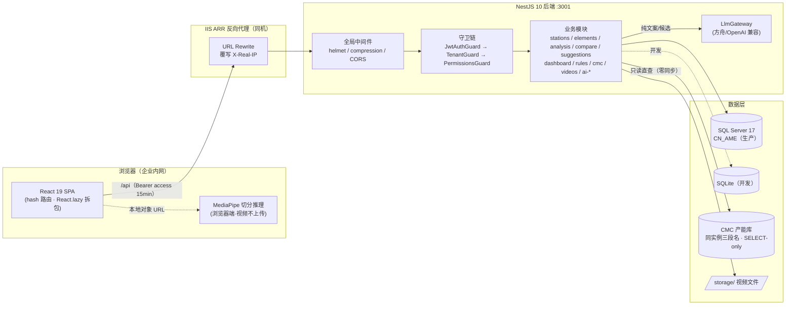

# IE Improvement Platform · Code Wiki

> 面向新加入的开发者 / Agent 的完整代码导航文档。
> 配套阅读：根目录 `AGENT必读.md`（第一入口 + API 契约速查 + 任务看板）、`项目记忆.md`（共享快照）、`.workbuddy/memory/`（工作日志）。
> 整理日期：2026-11-09

---

## 目录

1. [项目概览](#1-项目概览)
2. [仓库目录结构](#2-仓库目录结构)
3. [整体架构](#3-整体架构)
4. [技术栈](#4-技术栈)
5. [后端架构详解（app/api）](#5-后端架构详解appapi)
6. [前端架构详解（app/web）](#6-前端架构详解appweb)
7. [关键类与函数速查](#7-关键类与函数速查)
8. [领域口径与铁律](#8-领域口径与铁律)
9. [依赖关系](#9-依赖关系)
10. [项目运行方式](#10-项目运行方式)
11. [部署与运维](#11-部署与运维)
12. [测试体系与质量门禁](#12-测试体系与质量门禁)
13. [工程纪律与高频坑](#13-工程纪律与高频坑)
14. [参考文档索引](#14-参考文档索引)

---

## 1. 项目概览

### 1.1 定位

**IE（工业工程）改善平台** = 「AI 赋能的 IE 分析改善效率工具」。帮助 IE 工程师对工位作业视频做**动素级动作分解**，自动计算 VA / RNVA / NVA 工时结构、平衡率、瓶颈工位，给出改善建议并估算年化收益。

### 1.2 解决的痛点

- ME/IE 人员流动大，量产项目无暇做深度改善；
- 手工动作分析（秒表 / 录像回放）耗时且依赖老师傅经验。

### 1.3 产品哲学（长期有效）

> 工具做「薄」不做「全」——**帮 IE 更快看出问题 → 留；帮管理层管住 IE → 砍**。
> 审批、追踪、核算、报表、认证类管理功能一律砍掉或延后。

### 1.4 核心工作流

```
视频（本地上传/手机拍摄） → 动作分解（人拆：分解工作台逐要素标注起止点）
                          → AI 校验（规则引擎 + 可选 LLM 文案/切分候选）
                          → 分析（VA/RNVA/NVA、CT、平衡率、瓶颈、浪费触发）
                          → 对比（版本 Diff、收益估算）
                          → 改善建议（候选生成 → 采纳 → 改善任务）
```

### 1.5 部署环境

企业内网，Windows + SQL Server 17（生产库 `CN_AME`，同实例另有 CMC 产能系统库），IIS ARR 反向代理同机部署，并发口径 50+ 人。

---

## 2. 仓库目录结构

```
IE_Improvement_Platform/
├── package.json                 # 仓库入口：统一 build/typecheck/ops 脚本（不托管依赖）
├── AGENT必读.md                 # 第一入口：API 契约速查 + 任务看板 + 工程纪律
├── 项目记忆.md                  # 共享项目快照（背景/口径/技术栈/坑）
│
├── app/
│   ├── api/                     # ★ 后端：NestJS 10 + TypeORM 0.3（当前主线）
│   │   ├── src/                 # 源码（见 §5）
│   │   ├── scripts/             # migrate.ts（表结构唯一事实来源）/ seed / seed-demo / 运维脚本
│   │   ├── test/                # 冒烟 smoke / 契约测试 / 隔离测试 / UI 测试
│   │   ├── bin/                 # ffmpeg.exe（6.1.1 essentials 构建）
│   │   ├── storage/             # 上传视频存储
│   │   └── .env / .env.example  # 配置（gitignore，生产值在库）
│   ├── web/                     # ★ 前端：Vite 6 + React 19 + TS（当前主线）
│   │   ├── src/                 # 源码（见 §6）
│   │   ├── public/models/       # MediaPipe 模型（离线随包，禁 CDN）
│   │   ├── test/ test-*.cjs     # puppeteer-core UI 回归套件（.cjs，web 是 ESM）
│   │   └── vite.config.ts       # /api → 127.0.0.1:3001 代理
│   ├── server/                  # 旧 MVP（Express）：已全部平移，不再演进，仅历史参考
│   ├── config/rules/            # JSON 规则集（DB/文件双源中的"文件源"）
│   │   ├── va_rules.json        # VA 归类规则（RV 版本号）
│   │   ├── waste_triggers.json  # 浪费触发器（类型过滤器 DSL）
│   │   ├── motion_standard.json # 公司动作标准库（MS 版本号，41 类词表）
│   │   ├── ecrsa_map.json       # ECRS 手法映射
│   │   └── redline_keywords.json# 采纳红线关键词
│   └── config/benefit_params.json # 收益参数（费率/日产量/落地率）
│
├── deploy/
│   ├── iis/web.config           # IIS 站点配置（前端静态 + API 反代）
│   ├── sql/backup.ps1           # SQL Server 备份脚本（npm run ops:backup）
│   └── windows/*.ps1            # 审计保留策略计划任务注册/注销
│
├── docs/                        # 设计与运维文档（含本 Wiki）
│   ├── decisions/               # ADR（AI 切分、视频架构、开放决策）
│   ├── deployment/DEPLOY-CONFIG.md
│   ├── identity/SSO-INTEGRATION-PLAN.md
│   ├── ops/VIDEO-CAPACITY.md
│   └── specs/                   # 视频 P0 规格、AI 动作切分规格
│
├── deliverables/                # 版本化交付物（设计方案/截图/报告，按 v3xx 分目录）
├── scripts/                     # （空，历史遗留）
└── data/                        # 数据目录
```

---

## 3. 整体架构

### 3.1 系统架构图



### 3.2 分层原则

| 层 | 职责 | 关键约束 |
|---|---|---|
| 前端 SPA | 交互、视频引擎、手绘 SVG 图表 | 无路由库；无权限的数据**不发请求**（避免 403 横幅污染） |
| 守卫链 | 认证 → 租户 → 权限 | 未声明权限的接口默认拒绝 |
| 业务模块 | 领域逻辑 | 计算口径全部来自规则引擎（纯函数），版本号随结果透出 |
| 数据层 | TypeORM 统一实体 | `BaseRepository` 自动注入 `tenant_id`；显式事务走 `transaction()` 串行锁 |
| 外部系统 | CMC / LLM / ffmpeg | CMC 只读绝不写；LLM 禁产数字；ffmpeg 缺失→明确 503（宁缺勿错） |

### 3.3 「人拆 AI 校」三层 AI 架构

```
规则引擎（LLM 禁止产数字，定量结论一律规则引擎算）
        ↓
LLM（只做文案润色 / 切分候选 / 诊断解读，输出恒「待审」态，数字被剥除）
        ↓
人工审核（VA 改判必须带结构化标记理由；AI 建议采纳才落库）
```

---

## 4. 技术栈

| 层 | 选型 | 要点 |
|---|---|---|
| 前端 | React 19 + Vite 6 + TypeScript 5.6 | **无 router 库**，hash 路由手写（`App.tsx parseHash`）；图表手绘 SVG；15+ 页面 `React.lazy` 拆包 |
| 前端 AI | @mediapipe/tasks-vision 1.1 | HandLandmarker + 帧差运动能量双检测器，全部浏览器端推理，视频不上传 |
| 后端 | NestJS 10 + TypeORM 0.3 + Express | 端口 **3001**；全局 ValidationPipe `whitelist:true`；错误信封 `{title,status,detail,...}` 业务字段顶层透传 |
| 数据库 | SQL Server 17（生产 `CN_AME`）/ sqlite3（开发） | 同一套 Entity；`synchronize=false`（生产），表结构唯一来源 = `scripts/migrate.ts` |
| 认证 | JWT 双令牌（access 内存 15min + refresh localStorage 7d）+ OIDC/SSO（v3.57 统一身份） | 刷新轮换 + 重放检测；登录失败双桶限流 |
| 规则 | JSON 规则集，DB/文件双源 | DB 优先文件兜底；改 JSON 后必须 `POST /rules/:code/publish` 发布（不发布=静默不生效） |
| 视频处理 | ffmpeg 6.1.1（`app/api/bin/ffmpeg.exe`） | 探测/转码（libx264+yuv420p，宽 ≤1280）/场景切分/派生缓存 |
| 指标与告警 | prom-client（/metrics，METRICS_TOKEN 保护）+ core/alert（阈值规则 + 可选 SMTP） | 边沿触发 + 30min 冷却 |

---

## 5. 后端架构详解（app/api）

### 5.1 入口与全局装配

- **[main.ts](../app/api/src/main.ts)**：`dotenv/config` 首行加载 → 全局中间件（web 静态资源、helmet、compression、CORS）→ 全局过滤器/管道 → 设置全局前缀 `/api` → 输出启动信息（含 CMC 连接池预热）。
- **[app.module.ts](../app/api/src/app.module.ts)**：顶层模块装配，导入全部业务模块；**全局守卫链 `JwtAuthGuard → TenantGuard → PermissionsGuard`**（顺序即安全边界）。
- **[core/config/configuration.ts](../app/api/src/core/config/configuration.ts)**：`DB_TYPE` 控制 mssql/sqlite 双数据源；JWT、登录限流、规则目录、AI、OIDC、视频上限、告警等全部集中；对生产安全配置 **fail-fast 校验**。

### 5.2 横切层（core + rbac + tenant + audit + ai）

| 目录 | 职责 | 关键文件 |
|---|---|---|
| `src/core/config` | dotenv 配置单一事实来源 | configuration.ts |
| `src/core/database` | TypeORM 数据源 + 仓储基类 | database.module.ts（声明全部实体、双源切换）、**base.repository.ts**（租户注入 + 事务串行锁） |
| `src/core/rules` | 规则引擎宿主 | rules.service.ts（DB 优先/文件兜底、publish、启动自检）、rules.controller.ts、dsl.ts（浪费触发器类型过滤器 DSL）、rule-set.repository.ts |
| `src/core/all-exceptions.filter.ts` | 统一错误信封 | `{title, status, detail, errors?, warnings?, code?, requires?, allowed?, hint?, request_id}`，业务附加字段顶层透传 |
| `src/core/metrics.interceptor.ts` | Prometheus 指标 | /metrics 受 METRICS_TOKEN 保护（timingSafeEqual） |
| `src/core/web-assets.ts` | 生产托管前端 dist | — |
| `src/core/alert/` | 监控告警 | alert-rules.ts（纯函数阈值：登录锁定激增/ai_task 堆积/5xx 率）、alert-monitor.service.ts（边沿触发+冷却）、mailer.service.ts（可选 SMTP） |
| `src/core/shared/` | util / csv / ttl-cache | ttl-cache 用于驾驶舱 30s 缓存 + single-flight |
| `src/core/startup/` | ops:startup-check | 启动自检脚本入口 |
| `src/rbac/` | RBAC 权限 | permissions.guard.ts（未声明权限默认拒绝，`@RequirePermission` 多权限满足其一）、require-permission.decorator.ts、public.decorator.ts（`@Public()` 跳过认证）、full-access.ts（sys_admin/ie_admin 全权判定） |
| `src/tenant/` | 多租户 | tenant.guard.ts / tenant.interceptor.ts / tenant-context.ts（AsyncLocalStorage 租户上下文） |
| `src/audit/` | 审计日志 | audit.interceptor.ts（自动记录写操作）、skip-audit.decorator.ts |
| `src/ai/` | AI 公共基建 | **llm-gateway.service.ts**（fetch 封装、`thinking:{type:'disabled'}` 推理模型适配与 400 自动重试、maxTokens 预算）、output-sanitizer.ts（**剥除 LLM 输出中的秒/百分比/金额数字**——铁律②）、ai-usage.service.ts（token 用量）、ai-task.service.ts |

### 5.3 业务模块清单（src/modules/）

| 模块 | 路由前缀 | 职责 | 关键文件 |
|---|---|---|---|
| `auth` | /auth | 登录/刷新/登出/注册/找回密码/改密/me；JWT 双令牌轮换+重放检测；登录失败双桶限流（IP 15/5min、账号 10/15min，只计失败） | auth.service.ts、jwt-auth.guard.ts；子目录 `oidc/`（SSO 统一身份：oidc-client / state.store / sso-identity / sso-status-sync） |
| `users` | /admin/users | 用户管理（审批/建号/角色替换/停启用/代重置口令/下发重置码） | users.controller.ts（10 端点）、users.service.ts |
| `roles` | /roles | 角色与权限矩阵（v3.50 起支持自定义角色） | roles.controller.ts、roles.service.ts |
| `stations` | /stations | 工位 CRUD、复测（version+1 封存旧版）、空版本 400 护栏、版本列表、ACL（owner/协作者/产线共享，v3.42）、`from-cmc` 建工位、删除级联（AI 批次/建议/浪费） | stations.service.ts |
| `elements` | /stations/:id/elements | **核心模块**：要素清单（按版本）、validate（V1/V2/V3 干跑）、submit（整版删除后重插）、CSV import/export、VA 改判（va-class 必须带理由）/va-confirm；AI 写入守卫（含 ai_assisted 的版本提交须带回不少于原条数 AI 要素） | elements.service.ts、validation.ts（V1 描述/V2 同手时间链重叠/V3 循环数）、element.repository.ts |
| `lines` | /lines、/projects | 产线/项目主数据、`/lines/summary`（导航层产线概览）、`/lines/:lineId/analysis`（产线分析） | lines.controller.ts、projects.controller.ts |
| `analysis` | /stations/:id/analysis | 单工位分析（CT/VA 结构/浪费/异常/双手图数据）+ 产线分析（平衡率/瓶颈）；`analysis/diagnose`（v3.53 AI 诊断，模板降级） | **engine.ts**（纯函数计算引擎）、analysis.service.ts |
| `compare` | /stations/:id/compare | 版本对比（LCS 配对）、对比报告、`compare/interpret`（AI 解读 + 规则引擎回归预警） | engine.ts、compare.service.ts、improvement.repository.ts |
| `suggestions` | /improvements 等 | 改善建议生成（不落库）/采纳（红线 422 确认）/状态流转/建议书；改善任务列表（多维度过滤） | engine.ts（建议生成引擎）、suggestions.service.ts |
| `dashboard` | /dashboard | 集团/综合驾驶舱聚合（summary + improvements），五维筛选，30s TTL 缓存 + single-flight，v3.42 起全角色可见但非全权角色锁本租户 | dashboard.service.ts |
| `settings` | /config/benefit-params | 收益参数读取/整体替换；租户设置 | settings.controller.ts、tenant.controller.ts |
| `cmc` | /cmc | **CMC 产能系统只读集成**：factories/lines/projects 三级清单（同实例三段名直查，零同步；`escapeLiteral/escapeNumber` 白名单内联防注入；tedious requestTimeout 60s） | cmc.controller.ts |
| `videos` | /videos | 上传（直传/分片 chunk-upload/raw 免转码）、ffmpeg 探测/转码串行队列、`/videos/file/:name`（Range 206 拖动进度）、场景切分（scene>0.3，零 LLM）、派生缓存（derivative-*：低清代理/帧索引）、保留策略（video-retention） | videos.service.ts、videos.controller.ts、derivative-*.ts、video-retention.service.ts |
| `ai-suggest` | /ai-suggestions | AI 改善建议：批次/建议/自定义字典/配额/LLM 网关配置（profiles 多连接，t_ai_llm_profile 单活过滤唯一索引）/连接测试（两级最小代价：/models 零 token → chat 1 token）/e2e 自测 | ai-suggest.service.ts、**validator.ts**（R1-R3 三轮校验）、**calculator.ts**（服务端重算数字）、prompt.ts |
| `ai-waste` | /stations/:id/ai-waste | 浪费识别 + 问题清单自动生成（与 ai-suggest 完全独立：独立三表/校验 W1-W3/打分器）；双来源线（ai_assisted/manual）隔离；知识库 t_ai_waste_kb + 向量召回 | ai-waste.service.ts、validator.ts、prompt.ts |
| `ai-insight` | /stations/:id | AI 洞察（诊断/解读纯文案，恒待审 + 数字剥除 + 模板降级） | ai-insight.service.ts |
| `health` | /health /ready | 探活 | health.controller.ts |

### 5.4 数据层与实体

**双数据源**（[database.module.ts](../app/api/src/core/database/database.module.ts)）：`DB_TYPE=mssql`（生产，synchronize=false）| `sqlite`（开发，可自动建表）。同一套 Entity。

**核心实体**（src/entities/ + 各模块 entities/ 子目录）：

| 实体 | 表 | 说明 |
|---|---|---|
| TenantEntity | t_tenant | 租户（DEFAULT/OTHER 种子） |
| UserEntity | t_user | 用户（status/must_change_pwd/ai_quota/ai_quota_used） |
| RbacEntity | t_role / t_permission / t_user_role / t_role_permission | RBAC 五表 |
| RefreshTokenEntity | t_refresh_token | refresh 令牌（轮换+重放吊销） |
| PasswordResetEntity | t_password_reset | 仅存 sha256(code:user_id)，30min 一次性 |
| SsoEntity | t_sso_* | OIDC/SSO 身份映射与状态 |
| StationEntity | t_station | 工位（version/ct/tt/owner_user_id/roi/roi_zones/sop_steps） |
| LineEntity / ProjectEntity | t_line / t_project | 产线/项目主数据（CMC 本地快照） |
| **ElementEntity** | **t_element** | **全平台核心表**：seq/type/desc/va_class/start_ms/dur_s/hand/source(manual\|ai_assisted)/video_id/version |
| ImprovementEntity | t_improvement | 改善任务（source/ai_suggestion_id 溯源） |
| CollaborationEntity | t_station_collaborator / t_line_share | 工位级/产线级共享授权 |
| RuleSetEntity | t_rule_set | 规则集（code/rv/content，DB 源） |
| AuditLogEntity | t_audit_log | 审计日志 |
| VideoAssetEntity / VideoDerivativeEntity | t_video_asset / t_video_derivative | 视频资产与派生缓存 |
| AiTaskEntity / AiUsageEventEntity | t_ai_task / t_ai_usage_event | AI 任务队列 / token 用量 |
| AiSuggestionBatch/Suggestion/Setting/LlmProfile/CustomDict | t_ai_suggestion_batch / t_ai_suggestion / t_ai_setting / t_ai_llm_profile / t_ai_custom_dict | AI 建议子系统 |
| AiWasteBatch/Finding/Issue/Kb | t_ai_waste_batch / t_ai_waste_finding / t_ai_waste_issue / t_ai_waste_kb | 浪费识别子系统 |

**事务纪律**：显式事务必须走 `BaseRepository.transaction()`（内置全局串行锁，规避 sqlite 单连接并发问题）；单行即发即写用 `{transaction:false}`。

**约束命名**：`UQ_表_列 / FK_表_关联 / PK_表 / idx_表_列`；`desc` 是 SQL 保留字，裸 SQL 必须 `[desc]`。

### 5.5 规则引擎（配置即规则的单一来源）

```
app/config/rules/*.json（文件源）
        ↕  DB 优先、文件兜底（t_rule_set）
RulesService.getActive(code)   ← 业务模块注入（全局模块）
        ↕
POST /rules/:code/publish      ← 发布即全效（content.rv 即版本号），旧版仅留元数据
```

五组规则：

| code | 版本线 | 内容 |
|---|---|---|
| `va_rules` | RV3.x | VA 归类规则 41+ 条（VR01~VR42）：19 经典动素 ∪ 22 公司类型，判定表默认值 |
| `waste_triggers` | WT 系列 | 浪费触发器（类型过滤器 DSL，dsl.ts 解析；如 WT13「拿取 same_desc_count>=2」→重复取放） |
| `motion_standard` | MS1.x | 公司动作标准库：41 类词表 + 定义/起止点/描述格式/影响因素/判定说明 |
| `ecrsa_map` | — | ECRS 手法映射（浪费类别 → 取消/合并/重排/简化） |
| `redline_keywords` | — | 建议采纳红线关键词（未确认 → 422 REDLINE_CONFIRM_REQUIRED） |

### 5.6 分析引擎（计算口径核心，纯函数）

[modules/analysis/engine.ts](../app/api/src/modules/analysis/engine.ts)：

- **VA 归类**：`标记优先（[VA改判] 结构化标记）→ 例外规则 → 类型默认（va_rules）` 三级优先级；
- **单工位分析**：CT（Σ要素时长）、VA/RNVA/NVA 时间与占比、浪费触发命中、异常/待复核清单、双手作业图数据；
- **产线分析**：`buildLineAnalysis()` → 平衡率、瓶颈工位、CT/TT 差异、整线 VA 汇总。

收益公式（**固定，无默认值**，[benefit_params](../app/config/benefit_params.json)）：

```
年化收益(元) = 节省秒数 × 日产量 × 365 × 费率(元/h) ÷ 3600 × 落地率
费率/日产量未配置 → 阻断计算（不猜）
```

---

## 6. 前端架构详解（app/web）

### 6.1 入口、路由与布局

- **[main.tsx](../app/web/src/main.tsx)**：`createRoot` 渲染 App + 全局样式。
- **[App.tsx](../app/web/src/App.tsx)** — 三大职责：
  1. **懒加载路由表**（L14-36）：15+ 页面组件 `React.lazy(() => import(...))`，shell 常驻组件静态导入；三个 Suspense 边界（未登录三页 / mustChangePwd / 主内容区）。
  2. **手写 hash 路由**（`parseHash()` L80-129）：`#/page/id/p3/p4` 解析为 Route 对象；`ROUTE_PERMISSION`（L51-75）定义每页权限码，缺权限渲染缺权卡片**且不发请求**；`PUBLIC_PAGES`（register/forgot-password/oidc-callback）。
  3. **全局 shell**（L307-440）：顶栏（品牌 + 业务区/配置区/系统管理下拉三分区 + 用户菜单）、左侧对象树（工厂→产线→工位三级 / 集团树双模式）、面包屑、工位页签（StationTabs：分解工作台/AI 自动分解/分析结果/改善对比/AI 建议/浪费识别）、主内容区；工作台路由独占全宽（`wb-route` 定高 `100vh-48px`）。
- **路由守卫**：未登录→登录页；`mustChangePwd`→全站唯一可访问改密页；登录后无 hash 按权限分流 `#/dashboard` 或 `#/stations`。

### 6.2 API 层与认证

- **[api.ts](../app/web/src/api.ts)**：
  - access token 存**内存**（15min），refresh token 存 localStorage（`ie_refresh_token`，7d）；
  - `request()`（L92-114）：自动加 `Authorization: Bearer`；**401 → 单航班刷新 → 重放原请求**；刷新失败清 token 并广播 `auth:lost`；刷新成功广播 `auth:refreshed`（视频 URL 换 token 不断链）；
  - FormData 检测跳过 Content-Type 设置（不冲掉 boundary）；CSV 导出必须 fetch+blob（`<a href>` 带不上 token）。
- **[auth.tsx](../app/web/src/auth.tsx)**：AuthContext（bootstrap 恢复会话→/me；login/logout/changePassword；`can(perm)` 权限判定供路由/按钮级控制）。
- 错误信封字段（title/status/detail/requires/allowed...）由 `request()` 顶层透传给页面。

### 6.3 页面清单（src/pages/）

| 页面 | hash | 权限 | 职责 |
|---|---|---|---|
| DashboardPage | #/dashboard | group:read | 综合看板（五维筛选 + KPI + 五分布 + 产线横评 + 集团树） |
| StationListPage | #/stations（默认） | station:read | 工位卡片列表（我的/共享给我/全部视角 + 创建向导 + 共享/删除） |
| WorkbenchPage | #/workbench/:id | element:read | **分解工作台**（核心页）：视频监看 + 时间线 + 检查器 + 交付条单屏 |
| AiSegmentPage | #/ai-segment/:id | element:write | AI 自动分解（独立页，与工作台零耦合）：视频 + 候选表 + 写入区 |
| AnalysisPage | #/analysis/:id | analysis:read | 分析结果（山积图/双手图/饼图/浪费/明细卡 + AI 诊断） |
| ComparePage | #/compare/:id | compare:read | 版本对比 + 收益估算 + AI 解读 |
| DiffPage | #/diff/:id/:vA/:vB | element:read | 版本 Diff（LCS 配对四态 + 双轨时间线 + ECN 话术） |
| AiSuggestionsPage | #/ai-suggestions/:id | suggestion:generate | AI 改善建议（批次/校验轨迹/红线确认弹窗） |
| AiWastePage | #/ai-waste/:id | suggestion:generate | 浪费识别（AI 线/手工线页签 + 问题卡 ECRS + 决策流） |
| ImprovementsPage | #/improvements | suggestion:generate | 改善任务列表（多维度过滤 + CSV 导出） |
| MasterDataPage | #/master | station:read | 主数据（CMC 工厂/产线只读 + 本地工位维护） |
| SettingsPage | #/settings | settings:benefit-read | 设置中心（收益参数全线管理 + 规则库查看/发布） |
| StandardConfigPage | #/standard | rule:read | 动作标准库配置（表格编辑 + 发布升版） |
| AiConfigPage | #/ai-config | user:read | AI 配置（服务状态/LLM 网关/多连接 profiles/配额/字典/自测） |
| AiUsagePage | #/ai-usage | suggestion:generate | AI 用量 |
| VideoLibraryPage | #/videos | station:read | 视频库 |
| UserManagementPage | #/admin-users | user:read | 用户管理（审批/建号/角色/停启用/代重置） |
| RolePermissionPanel / RbacAuditPanel | 内嵌 | role:read / audit:read | 角色权限矩阵 / 审计面板 |
| LoginPage / RegisterPage / ForgotPasswordPage / ChangePasswordPage / OidcCallbackPage | 公开或 auth:self | — | 认证族页面 |
| HelpPage | #/help | — | 帮助 |

### 6.4 核心交互组件（src/components/ + src/video/）

| 组件/模块 | 职责与设计要点 |
|---|---|
| [useVideoEngine.ts](../app/web/src/video/useVideoEngine.ts) | 播放器引擎：帧步进（按实测 fps 吸附 23.976~120）、snap 到帧网格、J 键「点按后退」语义（Chrome 负 playbackRate 必抛异常，禁连续倒放）、毫秒时间码 |
| **WorkbenchPage**（~2500 行） | 分解工作台全量逻辑：三轨时间线（L/R/B）、JKL 传输、I/O 起止点、S 智能分割、Ctrl+K 工具箱、删除可撤销、复用要素、连续记录（回车=完成并下一个）、焦点策略（提交后 blur 回 body 保证 L 键即时生效） |
| [TypeSelect.tsx](../app/web/src/components/TypeSelect.tsx) | 动素类型自绘下拉：`createPortal` 挂 body（逃离 transform 包含块）+ rAF 帧级跟随 + 键盘导航；排除 Ctrl/Meta 组合键 |
| [SelectMenu.tsx](../app/web/src/components/SelectMenu.tsx) | 通用自绘下拉：portal + getBoundingClientRect + Flip 上下翻转（根治 DPI/缩放下原生 select popup 漂移） |
| [YamazumiChart.tsx](../app/web/src/components/YamazumiChart.tsx) | 山积图（纯 SVG）：VA/RNVA/NVA 堆叠 + TT 线 + 瓶颈/异常标记 |
| [HandsChart.tsx](../app/web/src/components/HandsChart.tsx) | 双手作业图（纯 SVG）：左右手块、空闲段、tooltip |
| [PieChart.tsx](../app/web/src/components/PieChart.tsx) | VA 结构饼图（纯 SVG） |
| [Toolbox.tsx](../app/web/src/components/Toolbox.tsx) | Ctrl+K 命令面板（四组 24 项命令，复用既有 handler） |
| [AutoBanner.tsx](../app/web/src/components/AutoBanner.tsx) | 校验横幅：× 手动关闭 + 分类自动消失 + 点击穿透（pointer-events:none） |
| [CreateStationWizard.tsx](../app/web/src/components/CreateStationWizard.tsx) | 新建分析对象向导：工厂→产线→项目（CMC 三级联动）→工位（编码自动生成可手输） |
| [ShareDialog.tsx](../app/web/src/components/ShareDialog.tsx) | 工位/产线共享授权 |
| [StationTree.tsx](../app/web/src/components/StationTree.tsx) / [GroupTree.tsx](../app/web/src/components/GroupTree.tsx) | 左侧三级对象树 / 集团树（管理层双模式） |

### 6.5 AI 切分子系统（src/ai-segment/，全部浏览器端推理）

| 文件 | 职责 |
|---|---|
| [motion.ts](../app/web/src/ai-segment/motion.ts) | **默认检测器**：抽帧 → 帧差运动能量（ROI 可按工位标定）→ 分级止点（≥500ms 长静止=确定边界 / 200-500ms 微停顿=合并候选）→ 合并回路 → 运动学分类（移物/目检/装配/拿取/等待/其他，全可解释规则）→ 手别判定（各自除以全片基线中位数再比）→ 浪费提示（等待/双手不平衡，只提示不定罪） |
| [landmark.ts](../app/web/src/ai-segment/landmark.ts) | MediaPipe HandLandmarker 加载与抽帧采样（时间戳必须严格单调递增；WebM duration=Infinity 兜底链） |
| [segmentation.ts](../app/web/src/ai-segment/segmentation.ts) | 手部检测器：掌质心速度 + 拇指食指开合度 →「运动→准静态」拐点=候选止点；四规则 R1-R4 降档 |
| [hoi.ts](../app/web/src/ai-segment/hoi.ts) | HOI 状态机：ROI 功能子区驻留推断 → 自动填「对象/位置」（拿取/放置/区内作业四结局） |
| [sop.ts](../app/web/src/ai-segment/sop.ts) | SOP 对齐：与工位配置步骤 LCS 保序匹配 → 漏步/重复/SOP 外动作；命中步骤自动命名（只覆盖机器生成态，手改永不被覆盖） |
| [index.ts](../app/web/src/ai-segment/index.ts) / [AiBatchConfirm.tsx](../app/web/src/ai-segment/AiBatchConfirm.tsx) | 汇总出口 / 批量接受二次确认弹窗（portal + 默认焦点取消 + Esc） |

**设计铁律**：候选绝不直接进草稿（submit 是整版重插）；候选以四重形状编码叠加进现有三轨（不加第 4 轨）；AI 写入走「封存→开新版→提交纯 AI」三步链（与手工数据按版本隔离）。

### 6.6 其他前端工具模块

- [diff.ts](../app/web/src/diff.ts)：版本 Diff 纯函数（LCS 配对 + descCompatible 守卫），15 项单测；
- [typeFreq.ts](../app/web/src/typeFreq.ts)：动素类型模糊检索（中文子串 + 拼音首字母 + 车间口语别名）+ 使用频次排序 + 手动录入自动归类（identifyVerb）；
- [actionCarryover.ts](../app/web/src/actionCarryover.ts)：动作对象智能预填（「上一动作→本动作」三级判定 yes/conditional/no）；
- [motionStandard.ts](../app/web/src/motionStandard.ts) / [motionStandardDefault.ts](../app/web/src/motionStandardDefault.ts)：标准库 format 模板解析与描述骨架生成（描述联想复用运行时 format）；
- [constants.ts](../app/web/src/constants.ts)：THERBLIG_GROUPS 动素三分法分组、ELEMENT_TYPES 41 类词表、PX_PER_SEC 等常量。

---

## 7. 关键类与函数速查

### 7.1 后端

| 位置 | 类/函数 | 说明 |
|---|---|---|
| core/database/base.repository.ts | `BaseRepository<T>` | 所有仓储的基类。find/create/update/remove 自动注入 `tenant_id`；`transaction(fn)` 内置全局串行锁；`{transaction:false}` 跳过 |
| core/rules/rules.service.ts | `RulesService` | `@Global` 规则服务：双源加载（DB 优先文件兜底）、启动自检、`getActive(code)`、`publish(code, content, operator)`（rv 版本治理，撞号自动顺延次版本） |
| core/rules/dsl.ts | 类型过滤器 DSL 解析 | waste_triggers 的规则表达式求值 |
| modules/analysis/engine.ts | `classifyElement()` / `analyzeStation()` / `buildLineAnalysis()` | VA 三级归类 / 单工位指标与浪费命中 / 产线平衡率与瓶颈。**纯函数，规则集注入，口径零隐藏** |
| modules/elements/validation.ts | `validateElements()` | V1（描述非空 + 改判理由）/ V2（同手时间链无重叠，止点恒等式 `start_ms + round(量化dur×1000)`）/ V3（循环数门槛）三道校验 |
| modules/elements/elements.service.ts | `submit()` | 整版删除后重插；AI 写入守卫（含 ai_assisted 的版本须带回原 AI 要素条数，409）；`bol_version = station.version` 写守卫（封存版只读） |
| modules/stations/stations.service.ts | `startRetest()` / `cancelRetest()` / `remove()` | 复测=version+1 封存旧版（空版本 400 护栏）/ 作废复测（AI 版本 409）/ 删除（ACL + AI 三表级联） |
| auth/auth.service.ts | `login()` / `refreshTokens()` | bcrypt 校验 + 双桶限流（只计失败，429 在 bcrypt 前）；refresh 一次性轮换 + 重放检测（重放吊销该用户全部会话） |
| rbac/permissions.guard.ts | `PermissionsGuard` | 未声明权限默认拒绝；`@RequirePermission('a','b')` 满足其一放行 |
| ai/llm-gateway.service.ts | `LlmGatewayService.chat()` | OpenAI 兼容 fetch；`disableThinking` 选项（方舟推理模型 `thinking:{type:'disabled'}`，网关 400 自动去参重试）；maxTokens 预算 1600~4000；content 空 + finish=length → 明确报错 |
| ai/output-sanitizer.ts | `sanitize()` | 剥除 LLM 文本中的秒/百分比/金额数字（中文「秒」用三 regex 兜底）——铁律②实现 |
| modules/ai-suggest/validator.ts | R1-R3 校验 | R1 Schema/引用/白名单；R2 ECRS 语义（VA 禁 E、eliminate_basis ≥8 字）；R3 冲突裁决与证据门 |
| modules/ai-suggest/calculator.ts | `scoreBatch()` | **服务端重算全部数字**（est_save_s/priority/tier），LLM 数字字段剥除——铁律②落地 |
| modules/ai-waste/validator.ts | W1-W3 校验 | 独立于 ai-suggest：seq 引用防幻觉/VA 禁 E/数量上界/CT 阻断 |
| core/shared/ttl-cache.ts | TTL 缓存 + single-flight | 驾驶舱 30s 缓存；50 并发同键只回源 1 次 |
| scripts/migrate.ts | 幂等 DDL | **表结构唯一事实来源**（生产 synchronize=false）；约束命名规范；存量升级 IF COL_LENGTH/IF NOT EXISTS |
| scripts/seed.ts / seed-demo.ts | 种子 | seed：2 租户/5 角色+自定义角色示例/权限点/5 用户/5 规则/3 工位；seed:demo：3 公司/11 线/62 工位/739 要素/90 建议（幂等，末尾打印清理 SQL） |

### 7.2 前端

| 位置 | 函数/组件 | 说明 |
|---|---|---|
| src/api.ts | `request()` / `refreshTokens()` | 401 单航班刷新重放；token 双存储 |
| src/App.tsx | `parseHash()` / `ROUTE_PERMISSION` | 手写 hash 路由解析与权限映射 |
| src/auth.tsx | `AuthContext` / `can()` | 会话恢复 + 权限判定 |
| src/video/useVideoEngine.ts | `stepFrame()` / `snapToFrameGrid()` | 帧级精度（实测 fps 中位数吸附）；J 点按后退（负 playbackRate 不可用） |
| src/diff.ts | `pairElements()` | LCS 配对 + descCompatible 守卫（防误导配对） |
| src/typeFreq.ts | `fuzzyMatchTypes()` / `identifyVerb()` | 三路检索 + 频次排序 + 手动录入归类 |
| src/actionCarryover.ts | 映射表 | 「上一动作→本动作」对象预填三级判定 |
| src/ai-segment/motion.ts | `detectSegments()` | 帧差能量切分主流程（ROI/分级止点/合并回路/运动学分类） |
| src/components/TypeSelect.tsx / SelectMenu.tsx | portal 下拉族 | rAF 跟随 / Flip 翻转 / 键盘导航 |

---

## 8. 领域口径与铁律

改代码前必须遵守（违反 = 返工）：

1. **动素三分法（v3.14+）**：19 类 = 有效 9（VA）+ 辅助 5（RNVA）+ 无效 4（NVA）+ 其他兜底；v3.16 起并入公司标准 22 类型，词表共 **41 类**（motion_standard MS1.x）。
2. **RNVA（不是 NNVA）**：必要非增值只能压缩不能直接删，全链路符号统一。
3. **VA 归类单一来源** = `va_rules` 规则表（可配置 + rv 版本号）。改判必须写结构化标记 `[VA改判|原:x|新:y|理由:z|人:w|日期]`，无理由后端 V1 拦截；类型变更时前端剥离旧标记。
4. **收益公式固定**：`节省秒数 × 日产量 × 365 × 费率 ÷ 3600 × 落地率`；费率/日产量**无默认值**，未配置即阻断（不猜）。
5. **版本语义**：工位版本 = 复测代数。复测 = version+1 封存旧版；写守卫 `bol_version = station.version`（封存版只读）；空版本 400 护栏。
6. **CMC 铁律（最高优先级）**：CMC 产能库全程 **SELECT-only 绝不写**；公司/产线/项目/分配关系以 CMC 为单一数据源（同实例三段名直查零同步）；CMC 不可达 → 明确提示宁缺勿错，不伪造数据。
7. **AI 三铁律**：① AI 建议永远「待审」态，无直接执行按钮；② LLM 禁产数字，定量结论一律规则引擎算（output-sanitizer + 服务端重算）；③ 模拟值绝不回写正式 ST。
8. **信息分层**：RBAC + 租户隔离保数据权限；信息密度按角色三档（管理层看平衡率/瓶颈聚合，执行层看待办/CT，只读层只看名称）；无权限的数据一律不请求。
9. **AI 数据隔离（v3.41+）**：AI 分解结果与手工工作台数据按版本隔离（AI 写入=封存旧版→开新版→纯 AI 提交）；浪费识别与改善建议按 element_source（ai_assisted/manual/mixed）双来源线隔离。

---

## 9. 依赖关系

### 9.1 后端运行时依赖（app/api/package.json）

| 依赖 | 用途 |
|---|---|
| @nestjs/{common,core,platform-express,config,jwt,passport,typeorm} | 框架全家桶（NestJS 10） |
| typeorm 0.3 + mssql 11 + sqlite3 5 | 双数据源 |
| bcryptjs | 口令哈希 |
| class-validator + class-transformer | DTO 校验（全局 whitelist:true） |
| helmet / compression | 安全头 / gzip+br |
| passport + passport-jwt | JWT 策略 |
| dotenv | 配置加载 |
| ffmpeg-static | ffmpeg 兜底（首选 bin/ffmpeg.exe） |
| prom-client | /metrics 指标 |
| nodemailer | 告警邮件（可选） |
| reflect-metadata / rxjs | Nest 基础设施 |

### 9.2 前端依赖（app/web/package.json）

| 依赖 | 用途 |
|---|---|
| react 19 + react-dom 19 | UI（无 router / 无状态库 / 无图表库——全部手写） |
| @mediapipe/tasks-vision | HandLandmarker（浏览器端切分） |
| vite 6 + @vitejs/plugin-react + typescript | 构建链 |
| puppeteer-core（dev） | UI 回归（puppeteer-core + 系统 Chrome） |
| lighthouse（dev） | 性能门禁 |

### 9.3 模块依赖方向

```
main.ts → app.module
  ├─ core/config ←（所有模块经 ConfigModule 读 .env）
  ├─ core/database ←（所有仓储继承 BaseRepository）
  ├─ core/rules（@Global）← analysis / suggestions / ai-suggest / ai-waste / elements / 前端 standard 页
  ├─ ai/*（LlmGateway @Global）← ai-suggest / ai-waste / ai-insight
  ├─ rbac + tenant + audit（守卫/拦截器横切全部业务模块）
  └─ modules/* 之间单向：
       stations ← elements（写守卫）← analysis ← compare / suggestions / dashboard / ai-*
       cmc ← stations(from-cmc) / 前端向导
       videos ← elements(video_id) / ai-segment 场景切分
```

### 9.4 外部系统

| 系统 | 方向 | 说明 |
|---|---|---|
| CMC 产能库 | 只读 | 同实例三段名直查（`CN_AME → CMC.dbo.*`），零同步 |
| LLM 网关 | 调用 | OpenAI 兼容（默认火山方舟 ark Plan 端点 + deepseek 推理模型）；t_ai_llm_profile 多连接单活 |
| OIDC / 统一身份 | 可选 | v3.57 MSIA/BOL SSO 集成（auth/oidc/） |
| ffmpeg | 本地二进制 | 探测/转码/场景切分/派生缓存；缺失→503 宁缺勿错 |
| SMTP | 可选 | 告警邮件（未配只落日志） |

---

## 10. 项目运行方式

### 10.1 前置条件

- Node ≥ 18（`engines` 约束）
- SQL Server 17（生产）或仅 sqlite（开发）
- ffmpeg（可选，`app/api/bin/ffmpeg.exe` 已随包）
- 测试需系统 Chrome（puppeteer-core）

### 10.2 环境配置

`app/api/.env`（gitignore；`.env.example` 为模板）。关键项：

```ini
NODE_ENV=production  PORT=3001
DB_TYPE=mssql            # mssql=生产 / sqlite=开发
DB_HOST=localhost  DB_PORT=1433  DB_NAME=CN_AME  DB_USER=sa  DB_PASS=<注入>
JWT_ACCESS_SECRET=…  JWT_REFRESH_SECRET=…  JWT_ACCESS_TTL=15m  JWT_REFRESH_TTL=7d
RULES_DIR=../config/rules
AI_ENABLED=false         # AI 总开关（LLM 配置也可 UI 化配置到 t_ai_llm_profile）
CLIENT_IP_HEADER=x-real-ip  TRUSTED_PROXIES=127.0.0.1
DASHBOARD_CACHE_TTL_MS=30000  DB_POOL_MAX=30  METRICS_TOKEN=<强随机>
```

### 10.3 常用命令（根 package.json 统一入口）

```bash
# 构建（api + web）
npm run build                    # = build:api + build:web

# —— 后端 ——
cd app/api
npm run build                    # nest build → dist/
npm run start:prod               # 生产启动 127.0.0.1:3001
npm run start:dev                # 开发 watch 模式（sqlite）
npm run migrate:prod             # 幂等 DDL（生产必须先执行）
npm run seed                     # 种子：2 租户/权限点/角色/5 用户/5 规则/3 工位
npm run seed:demo                # 演示数据：3 公司/11 线/62 工位/739 要素/90 建议（幂等可重跑）
npm run typecheck                # tsc --noEmit
npm run smoke                    # 143 项契约冒烟（回归门，依赖 seed 数据态）
npm run ops:startup-check        # 启动自检
npm run audit:retention[:apply]  # 审计保留策略（预览/执行）

# —— 前端 ——
cd app/web
npm run dev                      # Vite 5173，/api 代理到 3001
npm run build                    # 产物 dist/（React.lazy 拆包）
npm run typecheck                # tsc --noEmit
npm run test:perf                # 拆包预算门禁（首屏 gzip ≤120KB 等 6 项）

# —— 运维 ——
npm run ops:backup               # deploy/sql/backup.ps1 数据库备份
```

### 10.4 开发环境快速启动（sqlite）

```bash
cd app/api && npm install && npm run build && npm run seed && npm run start:dev
cd app/web && npm install && npm run dev     # 打开 http://localhost:5173
```

### 10.5 种子账号（口令 `123456`，首次登录强制改密）

| 账号 | 角色 | 租户 | 用途 |
|---|---|---|---|
| admin | sys_admin | DEFAULT | 系统管理员 |
| ie1 | ie_engineer | DEFAULT | IE 工程师（主力测试账号） |
| leader1 | line_leader | DEFAULT | 产线班长（曾在冒烟中被锁，联调避用） |
| viewer1 | viewer | DEFAULT | 只读（验证信息分层） |
| other1 | ie_engineer | OTHER | 他租户（验证租户隔离） |

---

## 11. 部署与运维

### 11.1 生产拓扑

```
用户浏览器 → IIS（静态托管 app/web/dist + /api 反代 → 127.0.0.1:3001）
           → ARR/URL Rewrite 必须覆写 X-Real-IP（否则 50 人共用 127.0.0.1 限流桶）
NestJS（node dist/src/main.js，PM2/服务方式常驻）
SQL Server 17（CN_AME 业务库 + CMC 产能库同实例）
```

### 11.2 部署步骤

1. `npm run build`（根目录，一次构建 api + web）
2. `cd app/api && npm run migrate:prod`（表结构唯一事实来源）
3. 首次：`npm run seed`；按需 `npm run seed:demo`
4. `npm run start:prod`（或 PM2 常驻）
5. IIS 指向 `app/web/dist`，`/api` 反代 3001；按 `deploy/iis/web.config`
6. **代码外必做**：IIS ARR 覆写 `X-Real-IP` 服务器变量；HSTS/证书在 IIS 层终结；`METRICS_TOKEN` 强随机

### 11.3 运维脚本

| 脚本 | 用途 |
|---|---|
| deploy/sql/backup.ps1 | SQL Server 备份（`npm run ops:backup`） |
| deploy/windows/register-audit-retention-task.ps1 | 注册审计保留 Windows 计划任务 |
| deploy/sql/manual/*.sql | 存量手工升级（SSO、视频保留策略） |
| app/api/scripts/clear-preset-data.ts | 清空预置业务数据（--yes 执行；**清库后严禁 npm run seed**，会重新植入种子工位） |

---

## 12. 测试体系与质量门禁

### 12.1 回归基线（发版底线）

| 套件 | 命令 | 基线 |
|---|---|---|
| 冒烟 smoke（契约） | `npm run smoke` | **143/143** |
| 联调 integration（前端全链路） | `npm run test:integration` | 31/31 |
| 认证管理 | `npm run test:auth-management` | 48/48 |
| 改密流 | `npm run test:change-pwd` | 全过（自动还原 other1 口令） |
| 设置中心契约 | `node test/settings-contract.js` | 20/20 |
| 驾驶舱契约 | `node test/dashboard-contract.js` | 30/30 |
| AI 建议/浪费契约 | `node test/ai-suggest-contract.cjs` / `ai-waste-contract.cjs` | 62/62 / 85/85 |
| diff 纯函数 | — | 15/15 |
| UI 专项（app/web/test-*.cjs） | node 逐个执行 | 按版本基线（v348 26 / v344 26 / v329 48 / …） |

### 12.2 三道门禁（AGENT必读.md「性能与安全门禁」）

```bash
# CI 快门（~40s，critical>0 阻断）
cd app/api && npm run build && npm run typecheck && node test/perf-security-baseline.mjs

# 发版门（~7min：200 工位容量 + k6 50VU + Lighthouse + 真实拖拽帧率）
cd app/api && npm run test:performance:isolated

# 回归门
cd app/api && npm run build && npm run smoke     # 143/143 必须全过

# 前端拆包门
cd app/web && npm run build && npm run test:perf

# 隔离安全门（临时 SQLite :3101，权限矩阵 125/125 + XSS 11/11）
cd app/api && npm run test:security:isolated
```

**前置铁律**：隔离门禁止指向 3001；正式库清库后严禁 `npm run seed`；UI 测试禁并行（互抢浏览器/工位资源）；测试收尾必须清理/复位（冒烟工位、锁定账号、空版本复位）。

---

## 13. 工程纪律与高频坑

完整清单见 `项目记忆.md` §5/§7 与 `AGENT必读.md` §4。最易踩的：

**后端**
- DTO 全字段必须带 class-validator 装饰器（全局 whitelist:true 会剥离无装饰器字段）。
- `desc` 是 SQL 保留字，裸 SQL 用 `[desc]`。
- TypeORM `ds.query` 跨库只收位置参数（命名参数报错）→ 白名单内联防注入；tedious 大查询 `requestTimeout: 60000`。
- 显式事务走 `BaseRepository.transaction`；改后端必须 rebuild + 重启服务（回归结论只对当前进程有效）。
- 规则改 JSON 后必须 `POST /rules/:code/publish` 发布（不发布=静默不生效）；`@Get('sets')` 必须在 `@Get(':code')` 之前。
- mssql 配额自增绑定名须 `@0`（@p0/? 均报错）；`TypeORM update({})` 空条件抛 Empty criteria。

**前端**
- React 钩子全在第一个条件 return 之前（否则登录后白屏）；受保护数据 useEffect 必须依赖 `user`（否则登录后空态）。
- UI 改动必须真实浏览器截图验证（tsc+vite build 抓不住白屏与布局溢出）；截图配 DOM 边车 JSON 机验。
- 负 playbackRate 必抛 NotSupportedError → 倒放一律「点按后退」。
- 原生 select 在用户 DPI/缩放下漂移 → 一律自绘下拉（portal + Flip）。
- 动画 to 关键帧勿留恒等 transform（fixed 浮层包含块错算）；fixed 浮层 createPortal 挂 body。
- 测试脚本用 `.cjs`（web 是 ESM）；puppeteer 双击须显式 clickCount 递进。

**测试脚手架**
- refresh token 一次性轮换：测试注入 token 后 reload 时序敏感，用 `?b=N` query 变更强制完整文档加载。
- UI 测试禁止依赖跨会话残留数据——自建前置 + finally 还原。
- 本机有 HTTP_PROXY：curl 本地必须 `--noproxy '*'`，探针走 127.0.0.1。

---

## 14. 参考文档索引

| 文档 | 内容 |
|---|---|
| [AGENT必读.md](../AGENT必读.md) | **第一入口**：API 契约速查（§5）+ 任务看板 + 性能门禁 |
| [项目记忆.md](../项目记忆.md) | 共享快照：背景/口径/技术栈/坑/回归基线 |
| docs/deployment/DEPLOY-CONFIG.md | 部署配置 |
| docs/identity/SSO-INTEGRATION-PLAN.md | 统一身份（MSIA/BOL）SSO 方案 |
| docs/ops/VIDEO-CAPACITY.md | 视频容量与保留策略 |
| docs/Spec-AI-动作切分-v1.0.md | AI 动作切分规格 |
| docs/decisions/ADR-*.md | 架构决策记录（AI 切分 001/002、视频 VID-001、开放决策） |
| deliverables/ | 各版本交付物（设计方案/评估报告/截图） |
| deliverables/动作标准与填写说明.md | 41 类动素标准与结构化描述填写说明（页面零提示文字的兜底文档） |
| .workbuddy/memory/ | 跨会话工作日志与 MEMORY.md |

---

*本文档由代码与 AGENT必读.md / 项目记忆.md 综合整理；版本语义以根目录 AGENT必读.md 任务看板为准（当前主线 v3.53+）。*
